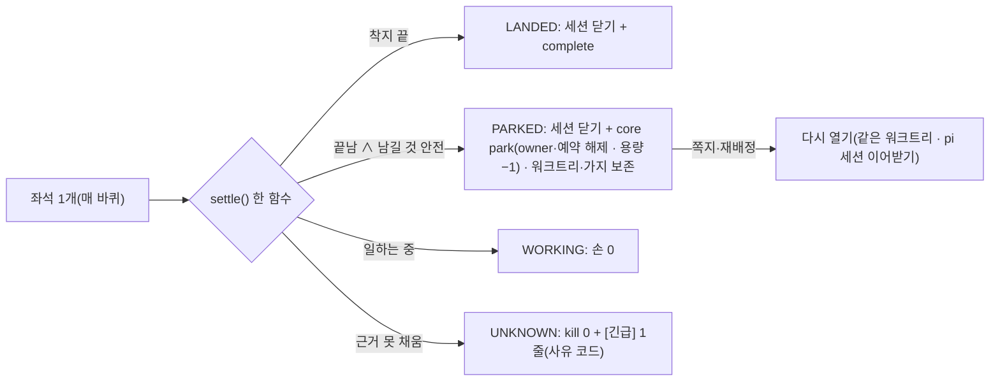

# DESIGN r2055 — 끝난 좌석은 한 길로 정리한다 («끝남» 판정 일반화)

> 이관(2026-11-15 · aifp-ft-arch-pi#15 · aifp 5297 · planner#322 배분 5296 · 오빠 Slack 1794753084.386519 «정본화 꼭 · 2.0 핵심»): 원본 = BYZ `origin/ops/main-base:design/harness/DESIGN-r2055-seat-settle-one-path.md` @457df3cdd1 184줄. 아래 본문은 원본 그대로다(고친 글자 0). 이 파일이 팩 정본 자리다. 계약·사례 = `feature-pack/fable-team/ft2/contracts/keeper-settle/` · 사고 기록 = `feature-pack/fable-team/troubleshoot/2026-11-15-ended-seat-not-closed-r2055.md` · 착지 코드 = 팩 d88ef381(PR 1246) · 77511fcc(PR 1249) · 4b0567c3(PR 1250).

- 지시: 오빠 Slack 1794730232.295539 «닫힘감지 닫기 제대로 아키해서 다시는 안나오게 · 일주일 해결 안 됨» · 1794730277.871759 «끝난 좌석 자동정리 완전 정상화 일반화. 신규케이스 대응되도록» · planner #307999 · #308005 · master#282 #308004 · #308007
- 작성: byz-harness-arch-pi#365 · 2026-11-15 · 읽은 판 = 라이브 ft2 2.0.60 · 1.x 1.1.292 · BYZ origin/main·ops/main-base
- 상태: 설계 r8(§12 정정 · 장기 좌석 끝남 근거 ↔ 닫기 자격(hil.md 보존) 분리 · S4 검증 집합 = 닫기 자격 좌석만 · DA#10 #308124 HOLD-DESIGN H1·H2 · byz-harness-arch-pi#366) · r7(CPU 단독 닫기 근거 0 · 유휴 = jsonl 무활동 ∧ CPU idle · ⑥ 일하는 pi 좌석 · planner #308115 · arch#14 #308113 · byz-harness-arch-pi#366) · r6(§3c tmuxc 판정 정본 · 시험 ⑨ 고침·⑲⑳ 추가 · DA 비차단 메모 3곳 정리 · §12 = 별도 동결 계약 표기 · master#282 #308101 · planner #308100 · 오빠 «tmuxc 안보냐고» Slack 1794731434.153879 · byz-harness-arch-pi#366) · DA#10 #308081 = r4 7f5ea7f5ac APPROVE-DESIGN(R1~R3 · r5 §12 는 승인 밖) · r5(범위 보탬 §12 · 오빠 Slack 1794731176.506669 · planner #308068) · r4(DA#10 HOLD #308057 R1~R3 정정 · 의무/용량 두 셈 · core park 동사 · r2054 b 보존 · UNKNOWN 지문) · r3(반쪽 회수 = result→return · master #308040 실측 반영) · r2(fable 5.2 원인 조사 반영 §3b · 시험 ⑨~⑫ 추가) · 다음 = DA 반박 → 나노 → 착지 → ft2 설치

## 0. 결론 (한 줄)
좌석 세션을 닫는 조건에서 «착지»를 뺀다. 세션은 «일이 끝났고 남길 것이 안전하면» 닫고, 착지는 일(work)의 상태로만 따로 센다. 모든 좌석은 매 바퀴 네 판정(착지 끝 · 쉼 · 일하는 중 · 모름) 중 정확히 하나를 받고, «모름»은 조용히 남지 않고 [긴급] 1줄로 드러난다.

## 1. 일주일 반복한 원인 (실측 · 원인 4개는 같은 뿌리)
| 원인 | 실사건 | 지금 길 | 뿌리 |
|---|---|---|---|
| ⓐ 끝났는데 착지 0 → «착지 줄 없음» 영구 HELD | knowledge 오사카 loom 1335분 · harness r1721·r1742·r1746·r1749 · v65 conn-1 | keeper_close.py:79~117 close = 착지 조상일 때만 kill · 아니면 HELD | 세션 닫기 = 착지에 묶임 |
| ⓑ 팀 걸친 카드 «카드 후보 0» | knowledge conn-2·3·4·6(카드 = design/teams/v65 · 팀 행 = design/teams/knowledge) | keeper_land.py:107~132 landing = 짝 표 → 팀 폴더만 · 0 → NOCARD → HELD | 카드를 못 찾으면 «끝남» 판정 자체 불가 |
| ⓒ 접수 칸 셈 | harness remaining 8/8 · r1968·r1973 세션 0 인데 owner(gen3 holder) 남음 → return «owner 있음 = 반환 거부» | record.py:147 remaining = done·returned 만 뺌 · :186 owner 는 result·reassess 때만 빠짐 · dispatch.py:73~79 owner 있으면 반환 거부 | 칸 = 장부 기준 · 세션 생사와 무관 |
| ⓓ keeper 가 ALL_STOP 안 읽음 | 지금 정지는 <팀>-tick/PAUSED 13개로 대신 | keeper.py:224~ _round = SKIP_TEAMS 만 봄 | 정지 신호가 두 벌 |

공통 뿌리: «세션을 닫아도 되나»를 «착지했나»로 대신 묻는다. 착지는 사람·DA·try-auto·HIL 이 끼는 긴 사슬이라, 그 사이 끝난 나노는 세션을 쥔 채 칸을 막는다. 카드·PR·장부 중 하나만 어긋나도 판정이 «판정 불가»가 되고, 그 판정 불가는 HELD 1줄로 끝난다(드러남 0).

## 2. 새 모델 — 세션과 일을 나눈다

- 일(work) 상태 = 장부(journal) 그대로: 착지 전 · 착지 · 완성. 세션 상태 = 살아 있음 · 닫힘. 둘을 한 칸으로 셈하지 않는다.
- 셈은 두 벌로 나눈다(§4): 의무 장부(record.remaining · 마감·재개가 보는 것 · 바꾸지 않음)와 용량 셈(새 함수 · 접수·fill 만 봄). PARKED 는 의무에는 남고 용량에서만 빠진다.

## 3. settle() — «끝남» 판정 한 길 (나노 · ft1·ft2 · 팀 걸친 카드 · 팩 리포)
입력 = 좌석 이름 1개. 근거는 아래 순서로 읽고, 먼저 채워진 판정을 낸다. 판정마다 사유 코드 1개를 남긴다.

| 순서 | 판정 | 근거(모두 읽기만) | 행동 |
|---|---|---|---|
| 1 | LANDED | 카드 «- 착지:» 줄 조상 ∨ nano/<work> merged PR(r1960) ∨ 카드 머리 완성후·아카이브·중단·대체(r1960 ending) | 유휴 확인 → kill 1 → complete(지금 B2 그대로) |
| 2 | WORKING | 양성 근거만: pane Working·스피너 ∨ jsonl 이 PARK_IDLE 안에 늘어남 ∨ tmuxc CPU 판정 busy(§3c · pane 후손 에이전트 %cpu ≥ 0.3) · 유휴 = jsonl 무활동 ≥ PARK_IDLE ∧ CPU idle(%cpu < 0.3 연속 2회 · 간격 30~45초) 둘 다 · ★CPU idle 단독은 유휴·닫기 근거 0★(pi 는 API 응답 대기 중 CPU 0.0 · planner #308115 · arch#14 #308113 실측 32석 중 27~29석) | 손 0 |
| 3 | PARKED | 유휴 ≥ PARK_IDLE(기본 60분) ∧ 워크트리 clean ∧ 가지 HEAD = origin 같은 가지(또는 base 위 커밋 0) ∧ 그 좌석 앞 미수신 쪽지 0 ∧ 그 work 에 uncertain·effect 표식 없음 | kill 1 → core 새 동사 `park`(§4 · owner·예약 해제를 한 줄로 내구화) → 용량 −1 · 의무 그대로 · 워크트리·가지·pi 세션 파일 보존 |
| 4 | UNKNOWN | 위 셋 다 못 채움(카드 못 찾음 · intent 없음 · dirty · push 안 됨 · git·tmux 실패 · 새 꼴) | kill 0 · [긴급] 1줄(좌석 · 사유 코드 · 다음 수) · 지문 = (team, work, attempt, reason) · 같은 지문 하루 1회 · 새 사유·새 attempt = 첫 1회 즉시 · 전송 실패는 지문을 소비하지 않음 · ROUND 줄에 unknown=N |

- 카드 찾기(LANDED 근거용) = 한 함수 `resolve_card(team, work)`: 짝 표(r1819) → 팀 폴더+쌍둥이 → 발주 본문 카드 경로(runtime/bodies · MAPPED 꼴만) → 0 이면 사유 코드 `card-none`. ⓑ 는 이 3단계로 풀리고, 카드를 못 찾아도 PARKED 길은 막히지 않는다.
- 1.x 나노 기록(ft-nano-record·ft-nano-close-due)은 역할이 다르다: ft2 `resolve_card` 는 «카드가 어디 있나», 1.x `resolve_owner` 는 «이미 찾은 카드의 차례 나노가 어느 명부에 있나»(r2054 A1~A5 · 카드 팀 명부 우선 → 0 이면 같은 폴더 다른 명부 · 기존 차례 우선 · 손상 명부 건너뜀 · due·landed 공통 함수). 둘을 한 함수로 합치지 않는다(DA R3).
- 팩 리포 나노(aifp) = 워크트리 remote 기준으로 같은 표 · PR 판정은 r1960 그대로.
- 다른 역할(팀장·arch·DA·tester): 끝남 근거 = 명부 `_replaced_by`(승계 · B3 retired 그대로) 또는 ft2 close 영수. 그 밖의 꼴은 settle 이 UNKNOWN 으로 드러낸다(조용한 보류 0). 장기 좌석은 PARKED 대상이 아니다(유휴여도 kill 0 · 승계 길만). 닫기는 끝남 근거 ∧ §12 닫기 자격(hil.md 보존) 둘 다 채울 때만.

## 3b. 입력 보강 — fable 5.2 원인 조사(planner#318 #308026 · state/team-main/planner/RESEARCH-fable52-close-idle-rootcause-20261115.md)를 settle 한 길에 넣는 법
조사의 원인 8줄을 각각 땜질하지 않고, settle 의 «근거 칸» 으로 흡수한다. 고친 뒤에도 새 꼴은 UNKNOWN 으로 드러난다.

| 조사 원인(파일:줄) | settle 에서 받는 곳 |
|---|---|
| 질문 선택 창 대기인데 마지막 줄 toolUse → WORKING(keeper_stall.py:47) | WORKING 은 «양성 근거» 만: pane Working·스피너 ∨ jsonl 이 PARK_IDLE 안에 늘어남. toolUse 로 끝나고 jsonl 무활동 15분+ ∧ tmuxc CPU 판정 idle 2회(§3c) 둘 다면 WORKING 아님 → UNKNOWN `waiting-input`([긴급] «사람 답 대기» · 팀장에게 · kill 0) |
| BYZ squash 착지 = PR CLOSED → «merged 만» 조회라 영원 HELD(keeper_endings.py:43) | LANDED 근거에 «원장 done ∧ 카드 완성 폴더» 와 «가지 커밋이 base 에 이미 있음(git cherry 전부 −)» 추가. 못 채워도 PARKED 가 세션·칸을 푼다 |
| 워크트리 가지 이름 ≠ nano/<work>(osaka · keeper_endings.py:57) | PARKED 조건은 «워크트리 HEAD 가 그 가지의 origin 과 같음» 만 본다(가지 이름 무관) |
| 카드 후보 = 자기 팀 폴더만(keeper_land.py:62-76 · keeper_endings.py:72-83) | resolve_card 3단계(§3) · landing·_card_end 가 같은 함수 |
| 카드 착지가 산문(«착지 67e557825a») · LAND 정규식만(keeper_land.py:24) | LANDED 근거 칸이 넓어져 산문 의존 0 · 카드 줄 보완은 지금처럼 [줄 보완] 쪽지 |
| 칸 = command 단위(record.py:150 · 같은 work command 2개 = 2칸) | §4 칸 셈 = work 단위 |
| accept 만 · dispatch 0(r1907 · keeper.py:291 은 dispatch 있는 work 만) | settle 대상 = 남은 일 장부의 모든 work · dispatch 0 이 PARK_IDLE 넘으면 UNKNOWN `accept-only`([긴급] 팀장 · 거두기 = r1925 길) |
| launch 실패를 handled 로 굳힘(keeper_next.py:239 · r1968·r1973) | intent failed ∧ 세션 부재 = 반쪽 → core `park`(reason launch-failed · §4.2) · 재시도는 fill 이 새 attempt 로 |
| HELD 는 state.open 미등록 → 통보 0(keeper_close.py:101 · 오늘 harness HELD 12,184줄) | HELD 낱말 폐지: 판정마다 LANDED·PARKED·WORKING·UNKNOWN 중 하나 · UNKNOWN 은 [긴급] 하루 1회 + ROUND unknown=N · 같은 좌석·같은 사유 반복 로그 0(변할 때만 1줄) |
| aifp 명부(seats-aifp.json)는 B3 범위 밖(keeper_close.py:224-233) | 장기 좌석 승계 끝 판정 = keeper roots 목록(FETCH_TARGETS 와 같은 표)의 모든 명부 · 목록 밖 리포 좌석 = UNKNOWN `roster-outside` |

## 3c. tmuxc 판정을 같은 정본으로 쓴다 (master#282 #308101 · 오빠 «tmuxc 안보냐고»)
settle 은 «살아 있나·일하나» 를 새로 정의하지 않는다. tmuxc 가 이미 쓰는 규칙을 그대로 정본으로 삼는다.

| tmuxc 기존 판정(정본) | 위치 | settle 에서 쓰는 곳 |
|---|---|---|
| UC12 멈춤 = CPU 우선: 에이전트 %cpu < 0.3 연속 2회(30~45초) · 화면 잔상(toolUse·Running…)보다 CPU 가 최종심 | ~/.agents/skills/tmuxc/SKILL.md UC12 12-1 · 9-2 | CPU busy = WORKING 양성 근거. CPU idle 은 jsonl 무활동과 AND 일 때만 유휴로 센다(단독 = 근거 0 · pi API 대기 = CPU 0.0 · #308115). 질문 창 좌석 = toolUse 끝 ∧ jsonl 무활동 15분+ ∧ CPU idle 2회 → ⑨ · 일하는 pi 좌석 닫힘 0 → ⑥ |
| 에이전트 pid = pane 아래 모든 후손(얕은 pgrep -P 는 npm exec → node → 바이너리 사슬을 놓침) | ~/.local/bin/tmuxc pane_descendant_pids | CPU 를 잴 pid 집합. 얕은 자식만 재지 않는다 |
| UC6 clean = pane 명령이 셸(zsh·bash·fish)만 = 에이전트 끝난 shell-only 세션 | ~/.local/bin/tmuxc cmd_clean | 나노 shell-only = 에이전트 종료 근거(WORKING 아님). 남길 것 안전이면 PARKED · 아니면 UNKNOWN `shell-only-unsafe` |
| UC10 distill keep-last-2(계보당 최근 2 보존) · hil.md 표준승인(현역 보존 · 직전 세대는 검증된 재개 기록 있을 때만) | SKILL.md UC10 10-2 6단계 · ~/.claude/guides/hil.md 9행 | 장기 좌석 «끝남 근거»(`_replaced_by` ∧ 후계 ready 영수 · 또는 close 영수)와 «닫기 자격»(보존 조건)을 나눈다. ready 영수는 끝남 근거일 뿐 보존 조건을 대신하지 않는다(DA#10 #308124 H1) · 나노 계보는 hil.md 나노 표준승인대로 keep-last-2 면제 |
| tmuxc ls 상태 칸(claude ✅·❌ · zombie(shell-only)) | SKILL.md list 예시 | 같은 세션의 settle 판정과 어긋나면 그 세션 = UNKNOWN `tmuxc-mismatch` [긴급] 1줄(두 도구가 다른 «끝남» 을 내지 않게) |

- ★닫기 근거 규칙★: 닫기(PARKED·LANDED kill)는 «끝남 근거(착지·done·명부·shell-only) ∧ jsonl 무활동 ≥ PARK_IDLE» 일 때만. CPU 는 닫기 쪽 근거로 혼자 쓰이지 않는다(tmuxc UC12 의 «CPU 최종심» 은 claude 멈춤 판정용이다. pi 는 API 대기 중 CPU 0.0 이라 그대로 옮기면 일하는 좌석을 닫는다).
- 구현 꼴: settle 은 매 keeper 바퀴에 CPU 표본 1개만 잰다(외부 호출 7초 룰). 직전 바퀴 표본을 state 에 두고, 두 표본 간격 ≥ 30초 ∧ 둘 다 < 0.3 이면 idle. 문턱 0.3·간격 30초는 tmuxc UC12 값을 상수 하나로 둔다.
- tmuxc 코드를 부르지 않는 이유 1줄: tmuxc 는 bash 전역 도구라 좌석마다 외부 호출이 늘고 CPU 2회 판정이 30초 넘게 걸린다. 그래서 규칙(문턱·후손 pid·셸 명령 목록)만 같은 값으로 쓰고, 같은 입력에 같은 답을 내는지 대조 시험(⑳)으로 묶는다.

## 4. 셈 두 벌 · park 동사 (ⓒ · DA R1·R2 정정)
### 4.1 의무 장부와 용량 셈을 나눈다 (R1)
- 의무 장부 = 지금 `record.remaining`(record.py:147 · command 목록) 그대로. intake 밖 호출자 lifecycle.py:326(마감 gate) · reopen.py:137(재개 queue) · projection.py:80 은 이 값을 계속 본다 → 끝나지 않은 일이 마감·재개에서 숨지 않는다.
- 용량 셈 = 새 함수 `record.capacity(state, records)`: remaining 의 command 를 work 로 묶은 집합(work 없는 command = command 하나가 1칸)에서 «최신 attempt 가 parked 인 work» 만 뺀다. 호출자 = intake `_full`(intake.py:174) · keeper fill(keeper_next.py:173-185) · projection 새 칸 `capacity`(옛 `remaining` 칸 이름·값 그대로).
- 같은 work 의 command 2개 = 의무 2줄(본문·영수 보존) · 용량 1칸.

| 상태(같은 state·journal 판독) | 의무 장부 | 용량 셈 | 드러냄 |
|---|---|---|---|
| WORKING | 셈 | 셈 | — |
| PARKED(최신 attempt parked) | 셈 | 안 셈 | — |
| accept-only(dispatch 0) | 셈 | 셈 | PARK_IDLE 넘으면 UNKNOWN `accept-only` |
| UNKNOWN(그 밖) | 셈 | 셈(모르면 안전 쪽) | [긴급] |
| launch opening | 셈 | 셈 | — |
| launch failed(intent failed ∧ 세션 부재) | 셈 | 안 셈(`park` reason launch-failed) | fill 이 새 attempt 로 다시 |
| returned(r1990) · done | 안 셈(지금 그대로) | 안 셈 | — |

### 4.2 park — owner·예약 해제를 한 줄로 내구화 (R2)
- core 새 공개 동사 `park(work, attempt, reason)`(Dispatch · writer.lock 비차단 1회 · 점유 = BUSY). 쓰는 줄 = journal `parked` 1줄 {attempt, reason(idle-done · launch-failed), released:[자원], owner_released:{holder,gen}}.
- fold(record.recover_state) = owners.pop(work) · reservations 에서 그 work 행 제거 · state.parked[work]={attempt,at,reason,released} · 같은 work 의 뒤 dispatch 가 parked 를 지움(returned 와 같은 꼴 r1990).
- 거절: attempt ≠ 최신(낡은 attempt) · done · uncertain 또는 effect 미확정(기존 확정 gate 그대로 → settle 은 UNKNOWN) · 이미 parked 같은 attempt = HOLD 멱등(쓰기 0).
- crash: journal 줄 뒤 state 쓰기 전 죽으면 recover_state 가 같은 fold 로 앞선다(기존 복구 규칙) · 다시 부르면 멱등 HOLD.
- done 을 꾸며 예약을 푸는 길(complete·reassess 우회) 0 · `result`→`return` 은 자동 길에서 쓰지 않는다(예약이 남음 · DA 재현).
- 다시 열기: PARKED·launch-failed work 에 새 dispatch(같은 자원 R 포함) = 예약이 풀려 있어 배정 성공 → 같은 워크트리로 열기(pi 세션 파일 이어받기 · 실패 = 새 세션 + 첫 본문 «이어서» 1줄).
- 세션 0 · owner 남은 반쪽(r1968·r1973 꼴) = intent failed·closed ∧ tmux 부재(rc1 «can't find session» 만) → 같은 `park`(reason launch-failed). 그 밖 판독 = UNKNOWN `owner-orphan`.

## 5. 정지 신호 한 벌 (ⓓ)
- keeper 는 매 바퀴 `.fable-team/state/ALL_STOP.json` 을 읽는다(있고 해제 표식 없음 = 정지).
- 정지 중: 실행 단계 전부 0 — LANDED·PARKED kill · B3 승계 닫기 · stall 깨움·재배정 · fill spawn · park 쓰기(조건 21 · 정지 사유 «세션 kill·손 닫기 0») · settle 판정과 [긴급] 드러냄은 계속(무엇이 닫힐지 «예정» 줄로 남김).
- <팀>-tick/PAUSED 13개는 1.x 틱용으로 두되 keeper 는 읽지 않는다. 팀 단위 제외는 지금처럼 SKIP_TEAMS 하나.
- 못 읽음(JSON 깨짐) = 정지로 본다(안전 쪽) + 판정 불가 1줄.

## 6. 처음 1단계 — 칸 0 에서 r2055 나노 열기
- master 손(지금 · 설계 착지 전 1회): 두 work 에 core `result` → `return` 순서.
  - `python3 <ft2>/core/cli.py result --root <BYZ> --team harness --work r1968-landing-wait-alarm-auto-land --holder byz-harness-nano-r1968-landing-wait-alarm-auto-land#0 --gen 3` (낱말 기본 «회수 결과» · 인자 꼴은 cli USAGE 로 확인)
  - 같은 꼴 r1973-keeper-skip-cards-needing-pre-da · holder byz-harness-nano-r1973-keeper-skip-cards-needing-pre-da#0 · gen 3 (state.json owners 실측 값)
  - 그 뒤 planner #307999 ① return 2건 → remaining 6/8 → r2055 나노 1석. `result` 가 «결과 미확정 = 재실행 0» HOLD 로 막히면 [확인 필요: _hold 갈래 · execution.py _step] → 막힌 낱말 그대로 회신
  - 주의(DA R2 재현): result→return 은 그 work 의 자원 예약을 남긴다 → 같은 자원으로 다시 배정하면 «resource» 거절. 이번 두 건은 반환(의무에서 뺌)이 목적이라 쓰되, 다시 열 일이면 r2055a 착지 뒤 `park` 길로.
- 설계 착지 뒤에는 settle 이 `park` 하나로 자동 처리한다(사람 손 0 · result→return 자동 길 0).
- 질문 창 3석(r1721·r1746·r1749)은 master 가 답해 푼다(#308028 · 각 첫 선택지) — 설계 ⑨ 의 실사건이다.

## 7. 즉시 시험 (나노 · 임시 루트 · 실 tmux·실 runtime 0 · 시험 1개 70초)
| 칸 | 입력 | 기대 |
|---|---|---|
| ① | 끝난 나노 · 착지 0 · clean · push 됨 · 유휴 ≥ 60분 | PARKED · kill 1 · journal parked 1줄 · 용량 −1 · 의무 장부 그대로 (기준판 = 착지 줄 없음 HELD = Red) |
| ② | 팀 걸친 카드(짝 표 없음 · 본문 경로) · 착지 줄 조상 | LANDED (기준판 = 카드 후보 0 = Red) |
| ③ | 세션 0 · owner 남음 · intent closed | park(launch-failed) 1회 · owner·예약 해제 · 용량 −1 · 의무 그대로 (기준판 = owner 남음 · 칸 그대로 = Red) |
| ④ | ALL_STOP.json 있음 + ① 입력 | kill 0 · fill 0 · «예정 PARKED» 1줄 |
| ⑤ | 새 꼴 주입(intent 에 worktree 칸 없음) | UNKNOWN · [긴급] 1줄 · kill 0 · 조용한 HELD 0 |
| ⑥ | 일하는 중(스피너) · 유휴 < 60분 / 일하는 pi 좌석(API 대기 · 후손 %cpu 0.0 표본 2개 · jsonl 5분 전 증가 · 스피너 없음) | 둘 다 WORKING · 손 0 · 닫힘 0 (기준판 아님 · CPU 단독 판정 변이 = 닫힘 = FAIL) |
| ⑦ | 유휴 ≥ 60분 · dirty 또는 push 안 됨 | UNKNOWN · [긴급] «dirty/unpushed» · kill 0 |
| ⑧ | PARKED 일에 새 dispatch | 같은 자원 R 로 새 배정 성공 · 같은 워크트리로 열림 · parked 지워짐 (기준판 result→return = «resource» 거절 = Red) |
| ⑨ | 질문 선택 창 대기(마지막 줄 toolUse · jsonl 무활동 15분+) · 에이전트 후손 %cpu 0.1 표본 2개(간격 30초) | jsonl 무활동 ∧ CPU idle 둘 다 → WORKING 아님 → UNKNOWN `waiting-input` · [긴급] 팀장 1줄 · kill 0 (기준판 = toolUse 로 WORKING · 로그 0 = Red) |
| ⑩ | 원장 done ∧ 카드 완성 폴더 · PR CLOSED(squash) · 가지 이름 다름 | LANDED 또는 PARKED · 세션 닫힘 (기준판 = 착지 줄 없음 HELD = Red) |
| ⑪ | accept 만(dispatch 0) · PARK_IDLE 넘음 · 같은 work command 2개 | 칸 1 · UNKNOWN `accept-only` [긴급] 1줄 (기준판 = 칸 2 · 통보 0 = Red) |
| ⑫ | launch 실패 intent failed · 세션 부재 · owner 있음 | park(launch-failed) · 용량 −1 · fill 이 새 attempt 로 다시 (기준판 = handled 굳힘 = Red) |
| ⑬ | PARKED W(done 0 · owner 0) 의 Lifecycle 마감 gate · reopen queue | blockers 에 PENDING_NOT_ZERO:1 그대로 · queue 에 W 남음(DA R1 모델 = Red 방지) |
| ⑭ | park 중간 crash(journal 줄 뒤 state 전) → 복구 → park 다시 | recover_state 가 parked 를 앞섬 · 두 번째 park = HOLD 멱등 · 예약 0 |
| ⑮ | uncertain 또는 effect 표식 있는 work 에 park | 거절(쓰기 0) · settle = UNKNOWN |
| ⑲ | 나노 pane 명령 = zsh(shell-only · 에이전트 끝남) · clean · push 됨 / 같은 꼴 dirty | 앞 = PARKED · 뒤 = UNKNOWN `shell-only-unsafe` [긴급] · 둘 다 WORKING 아님 (기준판 = 유휴 시간만 봄 = Red) |
| ⑳ | tmuxc 대조: 같은 가짜 프로세스 표(pane → npm → node → 바이너리 · %cpu 0.1/0.5) · 같은 pane 명령 표 | settle CPU 판정 = tmuxc UC12 규칙 답(후손 사슬 끝 pid 를 잼 · 0.5 = busy · 0.1×2 = idle) · shell-only 목록 = tmuxc cmd_clean 출력과 같은 세션 |
| ⑯ | 회귀: keeper·land·close·endings·stall·intake·dispatch·lifecycle·reopen 기존 시험 | 기준판과 같음(HELD 문구가 PARKED·UNKNOWN 으로 바뀌는 시험은 그 칸만 고침) |

실사건 시험(설치 뒤 master): ⓐ keeper 1바퀴 뒤 «끝난 나노» 0석 — 모든 ft2·1.x 나노 세션이 WORKING 이거나 [긴급] 목록에 있음 ⓑ 새로 끝난 나노 1석이 사람 손 없이 PARKED 또는 LANDED 로 닫힘.

## 8. 나눔 (카드 · 나노 · 순서)
1. r2055a ft2: core `park` 동사·`capacity` 셈 + adapters settle()·resolve_card·ALL_STOP (팩 ft2 · ①~⑯ · 이 설계의 몸통) · 완료 선언 = ft2 나노 실사건(ⓐ·ⓑ)만
2. r2055b 1.x: r2054 계약 A1~A5 그대로 보존(카드 팀 명부 우선 → 0 이면 같은 폴더 다른 명부 · 기존 차례 우선 · 손상 명부 건너뜀 · due·landed 공통 `resolve_owner`) + r2054 반례 ①~⑥ 을 필수 시험으로 · 완료 선언 = 1.x 팀 걸친 카드 landed 가 settle 없이 NEXT
3. r2054 카드는 2 에 계약·시험째로 옮긴 뒤 «대체: r2055b» 로 닫음(기능 손실 0) · r2055 원래 범위(본문 카드 경로)는 1 의 resolve_card 3단계
- 순서: 6 장 1단계(master) → 1 → 2. 완료 증거는 a/b 를 나눈다: 1(r2055a) = ft2 나노 실사건 ⓐ·ⓑ(§7 끝) · 2(r2055b) = 1.x 팀 걸친 카드 landed 가 settle 없이 NEXT.

## 9. 버린 안
- ⓧ 원인마다 땜질(noland 목록·짝 표 손 채우기·PAUSED 파일): 일주일 동안 이 길이었다. 새 꼴마다 또 HELD 가 된다.
- ⓨ 착지 사슬을 빠르게: 사람·HIL 이 끼므로 «끝난 세션이 남지 않음» 을 보장하지 못한다.
- ⓩ 유휴 시간만으로 kill: 커밋 안 한 일·push 안 한 가지를 잃는다. PARKED 는 «남길 것 안전» 조건이 있어야 한다.

## 10. 모르는 것 (≤5)
- pi 세션 이어받기(같은 세션 파일로 다시 열기)의 실제 동작 · [확인 필요: ft2 launch resume 길 · r2044]
- PARK_IDLE 60분이 DA 회신 기다리는 나노에게 짧은지 · 대리 지표 = 지난 14일 DA 회신 간격 [확인 필요]
- 1.x 나노와 ft2 나노가 같은 좌석 이름을 가질 때 두 도구의 kill 경합 · [확인 필요: 잠금 하나로 묶을지]
- 장기 좌석 «새 꼴» 의 범위(tester press 끝 등) — 설계는 UNKNOWN 드러냄까지만

## 11. DA 정정 대응 (HOLD 초회 #308057 · 동결 집합 R1~R3)
| 정정 | 설계에서 바뀐 곳 | 시험 |
|---|---|---|
| R1 PARKED 를 remaining 에서 빼면 마감·재개에서 미완료 일이 숨음 · command/work 단위 충돌 | §4.1 의무 장부(remaining 그대로)와 용량 셈(capacity 새 함수) 분리 · 상태별 표 · 같은 work command 2개 = 의무 2 · 용량 1 | ① · ⑪ · ⑬ |
| R2 result→return 이 예약을 남겨 재배정 «resource» 거절 | §4.2 core `park` 1줄이 owner·예약을 함께 해제 · fold·crash·멱등 · uncertain 은 기존 gate → UNKNOWN · 자동 길에서 result→return 0 · §6 주의 | ③ · ⑧ · ⑫ · ⑭ · ⑮ |
| R3 r2054 owner 명부 탐색은 resolve_card 로 흡수 안 됨 | §3 resolve_card(카드 자리) ↔ resolve_owner(차례 명부) 역할 구분 · §8 b 가 r2054 A1~A5·반례 그대로 · 완료 선언 a/b 분리 | r2054 ①~⑥(b 필수) |
| 권고 ③ UNKNOWN 지문 · ④ ALL_STOP 실행 전부 0 | §3 표 4행 지문 규칙 · §5 정지 중 실행 단계 목록 | ④ · ⑤ |

## 12. 범위 보탬 — 모든 좌석 · tmux 목록 기준 · 설치 직후 5분 실측 (오빠 Slack 1794731176.506669 · planner #308068)
- ★별도 동결 계약(DA#10 #308081)★: 이 절은 r4 승인 밖이다. r2055a 구현 발주에 동결 계약 S1~S4 로 따로 적고 DA 확인을 받는다(대상 이름 범위 · 장기 좌석 닫기 근거 · 정지 해제 전후 관측 조건). 설치 직후 닫힘 실측은 ALL_STOP 해제 뒤에만 한다(정지 중 = «예정» 줄 관측만).
- 대상 = tmux 목록의 `byz-*` 세션 전부(나노 · arch · DA · master · desk · tester). 좌석 종류는 명부 role 칸으로 정한다. settle 은 세션마다 판정 1개를 낸다.
- 장기 좌석(master·arch·DA·desk·tester) 끝남 근거 = 명부 `_replaced_by` ∧ 후계 [레디] 영수(mbox ready) · 또는 ft2 close 영수. 닫기 자격(끝남 근거와 따로 · hil.md «tmux 세션 정리 표준승인» 그대로): 계보(base#N · 이름 바뀐 승계는 `_replaced_by`·`_replaces` 양방향 ∧ 후계 생존 ∧ 재개 기록) 안 순번 1(현역)은 항상 보존 · 순번 2(직전 세대)는 검증된 재개 기록(~/.claude/state/seat-resume/<세션명>.json · ft-seat-retire 작성 · 프로젝트·대화 uuid 맞음)이 있을 때만 닫기 · 기록 없음·어긋남·codex·NORECORD = keep-last-2 하한(순번 2 보존) · 순번 3 이상 = 끝남 근거만 있으면 닫기 · 보존에 걸린 좌석 판정 = 사유 코드 `keep-recent`·`keep-last-2`(kill 0 · [긴급] 0 · 정상 보존). 대상 명부 = keeper roots 목록 전부(aifp 포함 §3b). 유휴만으로는 닫지 않는다(PARKED 대상 아님 · 일하는 중 = WORKING).
- 어느 명부에도 없는 `byz-*` 세션 = UNKNOWN `roster-outside`([긴급] · kill 0). 이름 lint 실패 세션 = UNKNOWN `name-bad`.
- tmuxc 세션 점검(정리 명령) 쪽은 settle 판정을 읽기만 한다 → 두 도구가 따로 «끝남» 을 판정하지 않는다(한 길).
- 설치 직후 실측(master · 5분 · 조건 21 패스 판정 · ALL_STOP 해제 뒤만): keeper 바퀴를 5분 동안 돌리고 매 바퀴 «세션 → 판정 · 사유 코드» 표를 남긴다. 검증 집합 = 관측 시작 바퀴에 «닫기 자격» 을 모두 채운 좌석(끝남 근거 ∧ jsonl 무활동 ≥ PARK_IDLE ∧ 남길 것 안전 ∧ 보존 조건 밖). 통과 = ① 검증 집합 좌석이 5분 안에 tmux 목록에서 사라짐 ② 판정 없는 `byz-*` 세션 0 ③ UNKNOWN 은 전부 [긴급] 1줄 ④ 검증 집합 밖(유휴 문턱 전 = WORKING · 보존 세대 = keep-recent·keep-last-2)은 판정·사유 코드가 맞는지만 보고 사라짐을 요구하지 않음. 어긋나면 그 세션·사유 코드를 그대로 회신(조건 21 미통과) · DA#10 #308124 H2
- 즉시 시험 추가: ⑰ 장기 좌석 보존(카드 ⑰ 여섯 사례 · 2세대 NORECORD 닫기 0 · 재개 기록 있으면 직전 세대 닫기 · 3세대 NORECORD 는 가장 오래된 세대만 · close 영수만 있는 현역 닫기 0 · ready 0 닫기 0 · 승계 안 된 유휴 = WORKING) ⑱ 명부 밖 `byz-*` 세션 → UNKNOWN `roster-outside` [긴급] 1줄 · kill 0.

## 13. 끝남 판독 순서 — 1차 tmuxc · 2차 pane (r9 · 오빠 결정 Slack 1794737865.879849 · planner#319 #308330 · master#283 #308331 · byz-harness-arch-pi#367)
- 결정 원문: «1차 = tmuxc 느슨한 연결 · tmuxc 없거나 판정 실패일 때만 2차 = pane 읽기(느리고 토큰을 더 씀 · 위로 거슬러 읽어야 해서)».
- §3c 고침: «tmuxc 코드를 부르지 않는다» 를 거둔다. keeper 는 바퀴당 `tmuxc clean` 을 1회 부른다(느슨한 연결 = 실행 파일 호출 · import 0 · 7초 · 재시도 0). CPU 규칙(문턱 0.3 · 간격 30초 · 후손 pid 깊이 8)은 지금처럼 같은 값을 쓴다.
- 1차가 선 좌석: shell-only = `tmuxc clean` 출력 · 일하나 = CPU busy ∨ jsonl 증가 · pane 글자는 읽지 않는다.
- 2차(pane 읽기)는 그 좌석의 1차를 못 세운 때만: tmuxc 없음·rc≠0·해석 실패 · ps·pane_pid 판독 실패 · pi 세션 파일 없음. 규칙 = planner arch#14 실측(AUDIT-close-blockers-20261115.md «H1 · H2» 절 · 27판정 중 어긋난 5건 모두 pane 이 맞음): capture-pane 끝 12줄 `Working`·`esc to interrupt` 있으면 일함 · 표본 2개 연속 없으면 쉼 · 입력줄 `❯`·`›` 뒤 글자는 근거 0.
- 둘 다 못 세움 = UNKNOWN `probe-fail` · 닫기에 필요한 jsonl 무활동을 못 잼 = UNKNOWN `session-none`. 판독 실패를 WORKING 으로 두지 않는다(A6 «양성 근거만» · arch 인수 탐침 4꼴 = 카드 ㉒).
- 그대로 두는 것: 세션 부재 확정 = raw `tmux has-session` rc 1 + «can't find session»(`tmuxc list` 는 tmux 실패를 빈 출력 rc 0 으로 삼켜 부재 근거가 못 됨) · kill 직전 가드(pane Working 줄 · attached)는 판정이 아니라 마지막 확인 1회. 1차가 쉼인데 이 가드가 Working 을 보면 UNKNOWN `tmuxc-mismatch`(§12 S3 의 판독원).
- 모든 닫기 길(착지 · park · orphan · 장기 좌석)이 이 한 판독을 지난다(DA#11 #308323 R1·R3). 시험 = 카드 ㉑·㉒ · ②⑩ 기대 정정.
