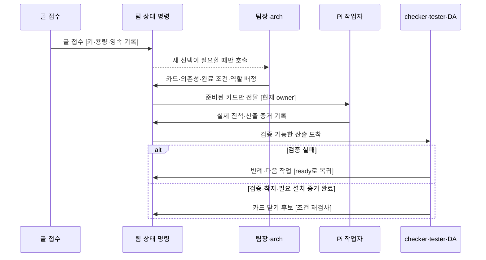
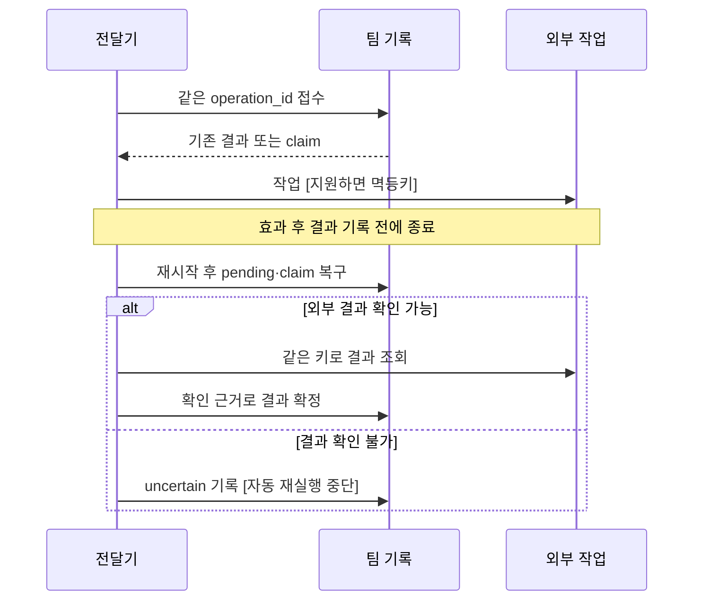

# ft 2.0 독립 기획: Astra의 팀별 직렬 상태 전이와 파생 대시보드

상태: 독립 초안 1. 사용자 선택·제품 구현 전. 작성자: 현재 Astra 메인(r1483). 기존 arch·DA 아이디어와 조사 정정은 이미 읽었다. 새 Fable·DA 독립 기획을 읽기 전에 이 초안을 고정한다. 다른 안과 닮은 계약도 독자성 때문에 버리지 않는다.
공통 발주: `/tmp/ft-2.0/three-proposals-brief.md`. 목표: 작은 완결된 일반화 → 기획·시뮬·반증 → 2.0 랜딩 → 실제 ft/BYZ 이관·설치본 검증.

## 1. 구조와 선택 이유

팀마다 같은 상태 전이 계약을 쓰고, 짧은 파일 트랜잭션만 팀 단위로 직렬화한다. 모델은 작업과 판단을 수행한다. 읽기·접수·시한 검사·중복 억제·마감 조건 계산은 공통 비모델 도구가 맡는다. 대시보드는 정본에서 파생한다.
하나의 중앙 팀장이 모든 일을 재판단하지 않는다. 동시에 각 세션이 공유 명부를 직접 덮지도 않는다. 팀 상태와 실행자 기록을 갱신하는 입구를 하나의 계약으로 제한한다.
이 안은 DA의 공통 명령 제안과 겹친다. 차이는 직렬화 범위를 팀으로 한정하고, 상위·하위 전달도 같은 접수 계약으로 처리하며, 영속 기록·효과·압축 경계를 초안에서 구체화하는 데 있다.
상주 writer 데몬은 필요조건이 아니다. 명령을 실행한 프로세스가 팀 파일 잠금을 짧게 소유한다. 실제 작업·네트워크·Git·모델 호출은 잠금 밖에서 수행한다. 기존 프로세스가 죽으면 OS 잠금이 해제되며 미완 사건으로 복구한다.
전제: 단일 머신의 로컬 파일시스템에서 먼저 검증한다. 네트워크 파일시스템·다중 머신 공동 쓰기는 이 계약의 검증 범위 밖이다. 독립 머신 간 팀 전달은 별도 접수·응답 경계로 모델링한다.

## 2. 정본과 최소 실행 표면

| 항목 | 정본·작성자 | 경계 |
|---|---|---|
| 골·카드·설계 결정·마감 증거 | 기존 `design/<팀>/` tracked 파일. 담당 역할이 변경하고 기존 검토·착지 경로 사용 | Git 커밋 여부가 모든 런타임 사건의 생존 여부를 대신하지 않는다 |
| 팀 현재 상태·미처리 사건·실행권·중복 결과 | 팀별 런타임 journal과 snapshot. 공통 전이 명령만 기록 | 잠금 안에서 owner·revision·용량 확인 후 사건을 영속화해야 접수 성공 반환 |
| 실행 중 세션 | runtime의 역할·작업·owner_epoch·프로세스 결속·시각 | 마지막 응답·heartbeat·실제 진척을 별도 필드로 저장 |
| 대시보드·역할별 좌석 | 현재 상태의 파생 조회 | 역할 이름으로 표시, 내부 epoch는 보존. nano는 담당 작업/역할로 구분 |
| lessons/evolution | 기존 기능·스캔·상한 계약 재사용 | 품질·자동 실행 상태·보존량은 별도 검증. prompt에는 버전 고정된 작은 snapshot |
| 과거 진단 이력 | 완료되고 현재 참조가 없는 항목만 회전 | 미처리 작업·미확정 효과·현재 복구 근거는 단순히 밀어내지 않음 |

논리적 도구는 세 가지 표면으로 제한하는 후보다: `apply`(접수·배정·관측·완료·마감 사건 제출), `inspect`(상태·시한 계산), `dispatch`(필요한 실행만 전달). 실제 명령 이름과 기존 도구 흡수 범위는 구현 전 확정한다. 세 이름으로 감싼 내부 누더기를 통과시키지 않으며 상태 전이·예외도 비교한다.
각 팀 루트의 상세 경로는 기존 PLAN `97f84ede64`의 이관 범위와 경로 조사 뒤 결정한다. 기존 `indices/`와 팀 루트는 유지한다. 이 초안은 명부·덮어쓰기 파일의 이동을 승인하지 않는다.

## 3. 상태 전이와 영속화 계약

카드 상태: `ready → running → verifying → closed`. 의존 대기·외부 대기는 `waiting`, 효과 결과를 잃은 경우 `uncertain`으로 따로 기록한다. 실패한 검증은 근거와 다음 작업을 연결해 `ready`로 돌아간다. 성공 보고만으로 `closed`가 되지 않는다.
팀 수명: 접수할 골 없음 → 골 접수 → 역할 실행 → 닫는 증거 확인 → 정리. 팀 모델 세션 종료와 비모델 접수기의 수명을 분리한다.
사건 최소 식별: team, goal, card, operation_id, expected_revision, owner_epoch, kind, payload, evidence. 사람 접수는 외부 요청 키를 보존하고 승인된 서비스 권한으로 들어오며 실행자 epoch 검사를 우회해 작업 결과를 쓰지 못한다.
팀 전이: 잠금 → 현재 manifest/snapshot+journal 확인 → 중복키·revision·owner·용량 검사 → 사건 한 건 append → flush/fsync → 상태 갱신 → 잠금 해제 → 접수 응답. 마지막 불완전 레코드는 복구 시 격리하고, 이미 접수 응답한 레코드의 소실은 시험 실패로 판정한다. 하드웨어 내구성은 별도 시험 없이는 보장하지 않는다.
외부 효과: `claimed` 기록 → 잠금 밖 효과 실행 → 결과 증거를 같은 operation_id로 확정. 효과 성공 후 확정 전에 죽으면 `uncertain`. 상대 시스템의 멱등키 또는 실제 결과 조회로 확인할 수 있을 때만 자동 복구한다. 파일 잠금만으로 외부 효과 정확히 1회를 주장하지 않는다.
owner 변경: 새 epoch를 발급하면 구 owner의 이후 상태 쓰기를 거절한다. 외부 효과 자체가 fencing을 지원하지 않으면 구 실행자의 in-flight 효과까지 차단할 수 없다. 확인 전 중복 배정하지 않고 불확실 상태를 노출한다.
팀 간 전달: 송신 팀의 pending → 수신 팀에 동일 operation_id로 durable 접수 → 수신 영수증을 송신 팀에 확정. 중간 crash는 같은 키로 재전달한다. 두 팀 잠금을 동시에 잡거나 교차 팀 원자 트랜잭션을 가정하지 않는다.

## 4. 상황별 텍스트 시퀀스

### 새 골과 병렬 작업

arch는 병렬 nano 분해·의존성·충돌을 관리한다. checker는 실행 증거, tester는 요구된 테스트, DA는 반례와 허용 범위를 판정한다. 팀장은 우선순위·범위·미확정 결과를 결정하고 전체 골 마감을 책임진다. planner도 같은 팀 계약을 쓰며 교차 팀 조정이 추가될 뿐이다.

### 무진행·외부 대기

실제 작업 사건 → 해당 카드의 last_progress와 다음 확인 시한 기록 → 비모델 inspect가 만료 카드만 확인 → 프로세스 생존·도구 실행·대기 원인과 함께 판정한다. 응답·단순 조회로 last_progress를 갱신하지 않는다.
진행 중이면 재촉하지 않고 재검사 시한만 조정한다. 근거 없는 침묵이면 같은 episode_key로 멈춤 사건 1건을 접수한다. ACK만으로 재무장하지 않는다. 새 작업 또는 실제 진척이 있어야 다음 멈춤을 따로 알린다.
`waiting`은 대기 대상·해제 사건·담당자·확인 시한을 가진다. waiting이라는 이름만으로 무기한 방치하지 않는다. 미확정·잠금 실패·관측 실패는 완료로 판단하지 않는다.
300초 제안: 무진행 임계 후보로 쓰되 검사 주기는 별도 값이며 최대 탐지 지연은 임계+검사 지연+실행기 장애 지연이다. «최대300초» 요구라면 확인 시한 예약과 허용 지연을 별도로 사용자와 정해야 한다.

### 재시작·중복·불확실 효과

### 마감과 새 골 경합

팀장 → 마감 요청(expected_revision) → 상태 명령은 진행·대기·미확정·미전달 0, 완료 증거와 설치 조건 확인 → closeout revision 기록 → 팀 모델 종료 요청. 사이에 새 골이 들어오면 revision 불일치로 마감을 재평가하거나 이미 닫힌 세대 뒤 새 세대를 연다. 접수된 골은 어느 경우에도 남긴다.
세션은 종료 전 본인 역할을 해제하고 마지막 산출·완료 범위를 기록한다. 비정상 종료는 owner 상태를 미확정으로 남겨 검사한다. 대시보드는 현재 owner만 표시하며 정리 로그와 골 완료 근거는 보존한다.
모든 모델이 종료한 뒤 새 골 → 살아 있는 파일 접수 입구 → root 팀의 새 pending → 비모델 dispatch → 적절한 팀 재개/생성. root 모델은 선택이 있을 때만 호출한다.

## 5. 실행기·보존·비용

루트당 하나의 기존 비모델 주기 실행기가 inspect/dispatch를 호출하는 배치를 초기 후보로 삼는다. 각 팀의 별도 cron을 늘리지 않는다. 팀별 처리 상한·예산·읽기 제한을 두고 실패한 팀은 건너뛰어 다음 팀을 처리한다. 공통 명령은 수동·사건 호출로도 같은 계약을 실행할 수 있다.
이 배치는 단일 실행기 장애 시 깨움 지연이 전 팀에 발생한다. 미처리 사건은 영속 저장되지만 즉시 진행은 보장하지 못한다. OS 재기동 감시와 복구 상한을 측정한다. 더 강한 가용성이 필요하면 같은 명령의 중복 실행 허용을 별도 검증한다. 배치 선택을 상태 정본 계약과 묶지 않는다.
압축: 잠금 아래 revision N의 snapshot 임시 작성·fsync → 새 journal 세대 준비·fsync → manifest 원자 교체·부모 디렉터리 fsync → 검증된 이전 세대만 정책에 따라 회전. 복구는 manifest가 가리키는 완전 세대만 사용하며 manifest 직전/직후 crash를 시험한다. 파일 여러 개를 각각 rename했다고 전체 원자성을 주장하지 않는다.
snapshot은 모든 미처리·미확정·현재 owner·참조 중인 완료 결과를 포함한다. 중복 결과 보존은 유효 요청 세대·재시도 기간과 연결한다. 만료 세대 요청은 신규 작업으로 재실행하지 않고 명시 거절한다.
완료 진단 이력은 총 바이트·세대 수 상한으로 회전한다. 활성 상태가 용량 상한에 도달하면 새 접수 성공을 반환하지 않고 명시 backpressure를 준다. 이미 접수한 일감을 DROP하지 않는다. 무한 접수와 유한 디스크를 동시에 약속하지 않는다.
Git 감사 기록도 무한 보관을 주장하지 않는다. 로컬 runtime 상한과 리포 이력 보관 정책은 분리해서 사용자 결정이 필요하다. 삭제가 필요한 정책은 명시 승인 범위에서만 집행한다.
측정 대상: 사건당 읽기/쓰기 바이트·파일 수, 잠금 대기, 프로세스 기동, 모델 호출·입력 토큰·캐시, 지연, 복구 동작 수. 현재 모두 이 안의 실측값은 없다. 공통 조사에서 나온 318/719를 이 설계 비용으로 재사용하지 않는다.

## 6. 자기 안을 깨는 반례와 실험

| 반례 | 검사·실패 판정 |
|---|---|
| 팀 잠금 장기 점유 | 잠금 안 외부 호출이 있거나 한 팀 지연이 다른 팀 처리를 막으면 실패. 짧은 lock 구간과 팀별 격리를 검증 |
| 세대 교체 중 구 작업 외부 효과 | 상태 쓰기 거절만으로 통과하지 않음. 실제 효과가 중복되거나 근거 없이 재배정되면 실패 |
| journal append·압축 중 crash | 접수 응답한 사건 소실, 복구할 manifest 세대 모호함, 최신 결과 덮어쓰기가 있으면 실패 |
| 동일 키 재시도와 보관 상한 | 만료 키를 새 작업으로 실행하거나 미처리 사건을 밀어내면 실패 |
| root 실행기 정지 | 새 골 접수 지속·재기동 후 회수 측정. 계약한 탐지/복구 지연을 못 지키면 배치 후보 수정 |
| 팀 간 송신 crash | 수신 접수 후 송신 확정 전 재전송에서 중복 효과·골 소실이 있으면 실패 |

공통 brief의 시나리오와 같은 사건 순서·데이터량으로 비교한다. fault injection 지점·판정식을 먼저 고정한다. 검사 스크립트가 구현 함수를 그대로 호출해 같은 버그를 공유하지 않도록 checker는 외부 상태와 효과 기록으로 판정한다.
초기 단계: planner1팀+작업1팀·작업자2개. 모든 계약 통과 후 여러 팀·백로그·재시작·실제 ft 적용으로 확장한다. 시험 하나70초·회차7분 한도에서 분할하며 실제 토큰 비용은 명시적인 모델 호출 측정 단계에만 잰다.
실험 실패를 숨기려고 예외를 추가하지 않는다. 공통 전이로 고칠 수 없으면 해당 구조 후보를 재평가한다.

## 7. 기존 기획·마이그레이션

1. aifp-ft 지원으로 소스·kit·live·실제 설치/기동 버전과 consumers를 구분한다. lessons/evolution·Slack mirror·seat binding 존재와 실행 상태를 확인한다. r1485 경로 조사 결과를 이관 입력으로 재사용한다.
2. 선택된 계약을 격리 경로에 구현·검증한다. 기존 명부·mbox·골 파일은 아직 정본이다. shadow 비교는 읽기만 하며 두 writer를 만들지 않는다.
3. 한 작업팀에서 새 접수 경계를 닫고 기존 writer를 멈춘 뒤 상태를 검증·전환한다. 전환 중 입력은 durable 접수 입구에 보존하거나 성공 ACK 전에 명시 거절한다. 조용한 수신 유실은 실패다.
4. 새 writer 활성화 뒤 owner·revision·전환 시점을 기록한다. 되돌림은 다시 쓰기를 차단하고 전환 뒤 접수·결과·미확정을 옛 형식으로 보존해 검증한 후 writer를 돌린다. snapshot을 append-only처럼 역이관하지 않는다.
5. 해당 상태를 옛 형식으로 보존할 수 없다면 롤백 가능하다고 주장하지 않는다. 전환 승인을 받기 전에 adapter 또는 다른 전환 방식을 선택한다.
6. 기존 PLAN의 그룹 생성·메모리·항목·runtime 도구 이관을 승인된 단계로 연결한다. 변경 전 참조 목록·비교·되돌림 증거를 남기고 팀별 확대한다.
7. 2.0 랜딩·배포 뒤 checker가 실제 설치본에서 골 접수·분배·검증·마감·새 골 재개를 확인한다. 남은 진행·대기 골이 0이고 모든 팀/루트 이관 증거가 있어야 전체 골을 닫는다.

## 8. 사용자 선택과 지원 확인

- aifp-ft: 기존 lifecycle/mbox/seat binding의 보장 범위, 폴더 일반화의 구현·설치 상태, 동시에 살아 있는 writer, 신규 계약으로 감쌀 수 있는 입구와 호환성.
- 선택: 300초의 의미, root 실행기 장애 시 허용 지연, 미확정 외부 효과의 사람 처리 책임, 완료 이력 보존량·재시도 세대 만료, 다중 머신 동시 쓰기 필요 여부.
- 추천 이유는 공유 RMW 유실을 직접 막으면서 중앙 모델 상주를 요구하지 않는다는 점이다. 반대 이유는 journal·snapshot 복구 계약과 팀 잠금이 추가된다는 점이다. 역할별 파일안보다 정말 단순한지는 동일 실험·운영 절차 비교 전에는 확정하지 않는다.
- 조사 근거: OMO c80279585d, gajae db554d3112, ft 비교 ce0b3f6379, checker a043add0ef, DA 정정275365. 이 문서의 새 설계에는 실행 검증 근거가 아직 없다.
