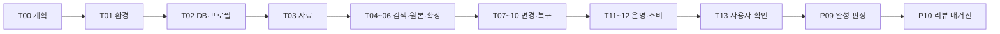

# AI RAG 풀 투어 가이드

작성일: 2026-09-13 · 진행 안내 갱신: 2026-09-27 / T06 연결 확장 기술 검증 완료, 사용자 확인 대기

**T05 사용자 확인을 마치고 T06 참조·의미 연결과 예산 제한을 검증했다. 다음 요청에는 T07 내용 갱신·요청 재생 한 단계만 진행한다.**
한 단계가 끝나면 결과와 남은 단계 목록을 출력하고 기다린다. 가이드 작성 요청은
투어 실행·사용자 수락·P-09 완성 판정·P-10 매거진 발행을 대신하지 않는다.

실제 진행 상태와 TODO의 정본은 [PLAN.md](../PLAN.md)다. 이 문서는 계획·실행 안내서이며
별도의 완료 체크리스트로 분리 운영하지 않는다.

## 1. 투어의 목적과 출발점

사용자가 자료를 넣고 검색 근거와 원본을 확인한 뒤, 확장·갱신·재시도·재색인·삭제·복원·
백업까지 직접 이해하고 확인한다. 마지막에는 만족한 기능과 남은 결함을 구분한다.
RAG가 최종 답변을 대신 작성하는 제품이라고 설명하지 않는다. 현재 엔진은 검색 근거를
돌려주며, 최종 답변 작성과 소비 서비스의 파일 감지·스케줄은 상위 애플리케이션 역할이다.

기존 검증 근거는 [P-07 완료 보고](p07-completion-20260913.json)에 있다.

- 오프라인 464 passed, 1 skipped. skip은 다른 테스트로 대체된 기존 placeholder다.
- 실제 모델 19개, 전체 형식·상태 12종/154개 CLI 명령 통과.
- 고정된 합성 자료 12개와 한영 질의 24개에서 정답 문서 1위 100%.
- 로컬 1,000문서/5,000청크 합성 벡터 측정에서 검색 p95 약 0.147초.

위 결과는 **당시 환경과 정해진 자료의 자동 검증**이다. 오늘의 연결 상태, 임의의 사용자
자료 품질, 사용자 만족을 보장하는 수치로 사용하지 않는다. 투어 중 나온 결과로 확인한다.

### 작업 경로

| 구분 | 위치/정책 |
|---|---|
| 실제 소스 워크트리 | `/Users/yoonhwan/Project/ai-feature-pack/.worktrees/rag-transplant` |
| 패키지 루트 | 위 경로의 `feature-pack/rag` |
| 원장 | `feature-pack/rag/docs/PLAN.md` |
| 기준 프로필 | [operational-profile-20260913.json](operational-profile-20260913.json) |
| 모델 식별 근거 | [p03-operational-model-identity-20260913.json](p03-operational-model-identity-20260913.json) |
| 투어 환경 | T01에서 새 전용 디렉터리와 DB를 정한다. 기존 검증 DB를 재사용하지 않는다. |

현재 tmux 프로세스의 시작 위치가 `cli-rag`여도 코드·명령은 위 실제 작업 경로를 명시한다.
예전 `/tmp` wheel·venv·테스트 DB가 남아 있다고 가정하지 않는다. 필요하면 소스로부터 새로
빌드·설치하고 wheel SHA와 설치 버전을 기록한다.

## 2. 진행 약속

### 사용자의 요청과 동작

| 요청 | 진행 방식 |
|---|---|
| `투어 시작` / `T00 시작` | 계획·자료·범위 확인부터 시작 |
| `다음` | 미완료 현재 단계가 있으면 이어서 마감; 없으면 다음 한 단계만 실행 |
| `T05 진행` | 선행 상태 확인 후 지정 단계 진행; 필요한 상태가 없으면 먼저 설명 |
| `다시 설명` | 같은 단계의 결과를 쉽게 설명; 등록·갱신 명령을 임의로 재실행하지 않음 |
| `다시 검증` | 같은 단계를 새 실행 기록으로 재검증; request ID 재사용 여부를 먼저 구분 |
| `현황` / `남은 목록` | 상태와 남은 단계만 출력하고 대기 |
| `중단` | 단계 종료 지점 또는 진행 중 상태를 기록하고 중단; 파일·DB·세션 삭제 없음 |
| `재개` | 원장과 투어 기록의 실제 경로·키 가용성·직전 결과부터 확인 |
| `건너뛰기` | 미확인 항목으로 남기고 다음 단계로 이동; 완료 처리하지 않음 |

`다음`은 다음 단계 실행 의사이지, 직전 단계의 결과를 모두 만족한다고 간주하는 답은 아니다.
사용자 확인이 필요한 항목은 실제 답변으로 기록한다. 명시적으로 연속 진행을 요청하기
전에는 한 요청으로 여러 단계를 자동 실행하지 않는다.

### 매 단계의 안내 형식

시작할 때:

> T04 / 검색 비교 · 이번 목표: 같은 질문을 한글과 영어로 검색해 근거를 비교합니다.
> 실행 대상: 전용 투어 DB / 컬렉션 tour-text. 사용자 확인: 첫 결과가 질문에 맞는지.

끝날 때:

> 실행 결과: 통과 / 실패 / 미확인. 실제 응답과 원본 위치: …
> 사용자 확인: 확인됨 / 의견 있음 / 아직 답변 없음.
> 다음 단계: T05. 남은 단계: T05~T13 목록. 여기서 대기합니다.

기술 실행 성공과 사용자 확인을 분리한다. 자동 테스트 통과만으로 P08-02를 완료하지 않는다.

## 3. 전체 경로와 예상 시간

표의 시간은 단계 안내·확인에 필요한 대략적인 활동 시간이다. 총 약 100~140분을
예상하되 로그인, 모델 로딩, 자료 변환, 사용자의 검토 시간에 따라 늘어난다.
여러 번에 나눠 진행해도 된다.

| 단계 | 주제 | 예상 | 완료하면 남는 것 |
|---|---|---:|---|
| T00 | 계획·자료·질문 확정 | 5분 | 합의한 시나리오와 질문 |
| T01 | 환경·모델·키 준비 | 8분 | 실제 경로·버전·연결·키 복구 방법 |
| T02 | 암호화 DB·프로필 생성 | 5분 | DB, profile_key, 초기 진단 |
| T03 | 자료 등록·추출 확인 | 12분 | 형식별 소스와 원본·추출 비교 |
| T04 | 한영 검색·품질 확인 | 8분 | 질의·순위·근거 기록 |
| T05 | 원본·출처·과거 근거 확인 | 6분 | 원본 바이트/위치와 manifest |
| T06 | 연결 확장·예산 확인 | 8분 | 확장 경로·분류·잘림 이유 |
| T07 | 내용 갱신·요청 재생 | 8분 | 새 리비전과 과거 응답 비교 |
| T08 | pending·실패·재시도 | 8분 | job 상태와 안전한 복구 결과 |
| T09 | 재색인·프로필 전환 | 6분 | 같은 원본의 새 처리 세대 |
| T10 | 논리 삭제·명시적 복원 | 6분 | 검색 가시성과 복원 기록 |
| T11 | 운영 진단·암호화 백업·복원 | 10분 | 새 백업/복원 DB와 대조 결과 |
| T12 | Python API·소비자 경계 | 6분 | API/CLI 일치와 명시 이벤트 동작 |
| T13 | 사용자 피드백·수락 판정 | 10분 | 사용자 확인 기록과 남은 결함 |

진행 의존 관계:



## 4. 자료와 질문 계획

T00에서는 아래 기본안을 제시한다. 사용자가 별도 자료를 지정하지 않으면 먼저 검증된
합성·공개 샘플을 사용한다. 사용자 파일을 자동 탐색하거나 폴더 전체를 수집하지 않는다.
선택된 원문은 전처리·임베딩을 위해 BYZ GPU로 전송되므로, 최초 확인에는 비민감 자료를 쓴다.

| 자료 묶음 | 예시 | 볼 내용 |
|---|---|---|
| 짧은 한글·영문 문서 | 도서관 운영·대출 규정 | 한영 질문, 숫자·조건·출처 |
| 연결된 Markdown 3개 | 환불 안내 → 증빙 → 지원 절차 | 제목 관계·명시적 참조·확장 |
| PDF·DOCX·XLSX | 재고 본문과 표 | 페이지·문단/XML·시트·셀 앵커 |
| HWP·HWPX | 검증된 공개 표·본문 샘플 | 지원 범위와 원본 복원 |
| OCR 이미지·글자 없는 그림 | 한글 문장 이미지, 기하 도형 | OCR와 비전 추론의 차이 |
| 대화·빈 문서·긴 문서 | 사용자/assistant 대화, 길이 비교 자료 | 턴 위치·ready_empty·청킹 |
| 사용자 선택 자료 1~3개 | 사용자가 지정한 실제 자료 | 실제 질문과 기대 근거 대조 |

기본 질문:

1. “책을 몇 권까지 며칠 동안 빌릴 수 있나요?” / “How many books can I borrow and for how long?”
2. “환불 신청에 필요한 증빙과 연결된 제출 절차를 보여줘.”
3. “커피 재고 수량이 적힌 원래 표와 위치를 보여줘.”
4. “이 이미지는 OCR로 읽은 것인가, 모델이 추론한 것인가?”
5. 사용자 자료마다 질문 하나와 예상 정답 위치를 **검색 실행 전에** 기록한다.

검색 결과가 없을 때 답을 만들어내지 않는다. 검색 순위가 높아도 근거의 사실성·원본
위치는 별도로 확인한다. 저장된 영어 번역과 원문은 같은 필드가 아니다.

## 5. 단계별 실행 안내

### T00 — 계획 합의

**제가 할 일:** 이 가이드의 목적·순서를 요약하고 기본 샘플, 사용자 자료, 질문을 정리한다.
전체 형식 확인은 기본 경로에 포함하되, 사용자가 특정 형식을 건너뛰면 미확인으로 기록한다.
논리 삭제 시연은 전용 투어 DB의 선택된 샘플만 대상으로 한다는 범위를 알린다.

**사용자 확인:** 보고 싶은 업무 사례, 선택 자료와 질문, 나눠 진행할 범위를 확인한다.

**통과 기준:** 문서·이미지·대화, 원본 조회·확장·갱신·삭제·복원 시나리오가 합의돼 있다.
이때 P08-01을 완료할 수 있다. 가이드만 작성된 현재는 합의 전이다.

**저장:** 자료 목록과 예상 근거, 단계 범위, 사용자가 확인한 내용. 다음은 T01.

### T01 — 환경·모델·키 준비

**제가 할 일:** 실제 워크트리와 CLI 경로, Python 3.13 환경, 패키지 버전을 확인한다.
wheel 사용 시 [설치 재현 기록](p07-install-reproduction-20260913.json)을 참고하고 현재
소스와 해시를 대조한다. `ai-rag manage doctor`의 런타임 검사와 모델 연결 검사를 구분한다.
현재 프로필의 두 `/v1/models`를 조회해 모델명·최대 길이·서빙 경로가 기대와 맞는지 확인한다.
인증이 만료됐을 때만 사용자 로컬 로그인 절차를 안내한다.

새 전용 실행 디렉터리에 투어 DB·입력 샘플·비밀이 없는 진행 기록을 둔다. 재개 가능한
키 보관 방법은 이 단계에서 정한다. 기본 제안은 사용자가 관리하는 비밀 저장소이며,
그 수단이 없으면 저장소 밖의 권한 제한된 **텍스트형 64자리 hex 키 파일** 보관 방식을
설명하고 선택을 받는다. 실제 키는 채팅·PLAN·보고서·argv·환경변수에 넣지 않는다.

현재 CLI는 `--key-fd`로 **32바이트 raw 키**를 읽는다. hex 문자열 자체를 fd에 보내면
안 된다. 각 명령마다 실행 측이 키를 읽어 raw bytes로 변환하고 새 pipe fd로 전달한다.
이전 명령이 소비한 fd를 다음 명령에서 재사용하지 않는다. macOS Keychain 자동 연동이
구현됐다고 안내하지 않는다. 과거 테스트의 메모리 전용 키는 지금 재사용할 수 없다.

**사용자 확인:** 설치·모델 사용 경로와 투어 키를 다시 사용할 방법을 이해했는지 확인한다.

**통과 기준:** 실제 경로·버전·모델 연결·키 재개 방법이 확인돼 있다. 모델이 없으면 이후
모델 의존 단계를 모의 결과로 바꾸지 않고 보류한다. 다음은 T02.

### T02 — 암호화 DB와 프로필

**제가 할 일:** 존재하지 않는 새 경로에 DB를 생성하고 선택 프로필을 등록한다.
프로필은 [기준 프로필](operational-profile-20260913.json)을 출발점으로 하되 실제
연결과 모델 근거를 T01에서 대조한다. 자료 어댑터별 normalizer가 다르면 별도 프로필을
등록하고 `profile_key`를 구분한다. CLI 출력을 그대로 기록하고 DB 진단을 실행한다.

**사용자 확인:** 원본·리비전·처리 세대·프로필이 각각 무엇을 뜻하는지 간단히 확인한다.

**통과 기준:** init와 profile 등록이 성공하고 실제 SQLCipher/FTS/vec 사용이 확인된다.
runtime doctor만 성공한 상태를 DB 정합성 확인으로 표시하지 않는다. 다음은 T03.

### T03 — 자료 등록과 추출

**제가 할 일:** 확정한 파일·문자열만 명시적으로 add한다. 자료마다 안정된 `source_key`,
고유 `request_id`, 실제 `profile_key`를 사용한다. 전체 형식 묶음을 진행하되 같은 단계
안에서도 형식별 결과를 짧게 보여준다. 원본·추출 텍스트·표·앵커·경고를 대조한다.
대화는 현재 지원 형식인 `application/x-airag-conversation+json`과
`{"turns":[{"role":"user","text":"…"},{"role":"assistant","text":"…"}]}`를 사용한다.

**사용자 확인:** 원문의 주요 문장·표·이미지 내용이 잘 들어왔는지, OCR 오독이나 누락이
있는지 본다. 문서 내 그림 보존과 별도의 비전 해석은 다르다는 점을 설명한다.

**통과 기준:** 원본 바이트 해시 일치, 형식별 추출·원문 위치 확인. 빈 문서는
`ready_empty`/검색 불가가 정상이며 실패나 가짜 검색 가능 상태로 표시하지 않는다.
OCR·비전은 오류가 없다는 추정 대신 실제 결과를 본다. 다음은 T04.

### T04 — 한영 검색

**제가 할 일:** 미리 정한 질문을 한글과 영어로 실행해 결과 순위, 원문, 번역,
`source_key`, 점수·근거를 나란히 보여준다. 각 소스의 프로필 공간에 맞춰 검색한다.
이미지 비전 결과는 추론임을 드러내고 직접 인용처럼 설명하지 않는다.

**사용자 확인:** “이 근거가 질문에 답하는가?”, “핵심 숫자·기간·금지 조건이 맞는가?”를 본다.

**통과 기준:** 정답 근거의 위치와 선택 이유를 설명할 수 있고, 누락·오역은 실패 사례로
기록한다. 새 사용자 자료의 순위를 기존 합성24질의100% 수치로 덮지 않는다. 다음은 T05.

### T05 — 원본·출처·manifest

**제가 할 일:** 검색 결과의 chunk/source/original을 조회한다. 페이지, 문단/XML, 시트·셀,
대화 턴 등 어댑터가 제공한 실제 앵커를 원본과 대조한다. 원본 바이트와 해시를 비교하고
`manifest_id`를 저장해 동일 결과를 다시 조회한다.

**사용자 확인:** 검색 근거에서 원본까지 따라갈 수 있는지 본다. 원문, 번역, 요약,
비전 추론을 구별할 수 있는지 확인한다.

**통과 기준:** 근거가 실제 원본 위치를 가리키고 manifest 재현이 가능하다. 없는 좌표를
추정해 표시하지 않는다. 다음은 T06.

### T06 — 연결 확장과 예산

**제가 할 일:** 연결된 Markdown 묶음에서 inline `search --expand`와 저장된 manifest의
standalone `expand`를 비교한다. 구조 관계·명시적 참조·추론된 의미 관계를 구분한다.
좁은 청크/토큰 예산과 넓은 예산을 각각 실행해 잘림 이유·소모량·중복 제거를 보여준다.
의미 연결은 `--include-semantic`으로 명시적으로 켠다.

**사용자 확인:** 추가된 근거가 왜 연결됐는지, 제한 때문에 어디서 멈췄는지 확인한다.

**통과 기준:** 범위·필터·예산·스냅숏을 지키며 미해결 참조를 숨기지 않는다. `tokens`는
확장 근거 JSON의 예산이며 원문 글자 수나 모델 전체 컨텍스트와 동일하지 않다. 다음은 T07.

### T07 — 갱신과 과거 응답

**제가 할 일:** 투어용 규정의 한 값을 바꿔 최신 `revision_token`으로 update한다.
새 요청에는 새 ID를, 동일 요청 재전송에는 원래 ID와 같은 payload를 쓴다.
새 검색과 T04의 과거 manifest를 비교하고, 이전 원본 리비전도 조회한다.
일부러 예전 CAS 토큰으로 별도 변경을 요청해 안전하게 거부되는지 확인한다.

**사용자 확인:** 최신 내용은 바뀌었지만 이전 검색 근거와 원래 요청 응답은 보존되는지 본다.

**통과 기준:** 내용 변경은 새 리비전, 중복 요청은 추가 발행 없음, stale 변경은 거부,
과거 manifest는 보존된다. source가 바뀐 뒤 옛 manifest로 새 standalone 확장을 요청하면
`STALE_SNAPSHOT`이 정상일 수 있다. 과거 근거 조회와 현재 확장을 혼동하지 않는다. 다음은 T08.

### T08 — pending과 실패 재시도

**제가 할 일:** 별도 투어 샘플을 프로필 없이 저장해 pending 상태를 보여주고,
`manage status`의 job ID로 명시적 프로필을 지정해 retry한다. 실패 시연은 투어 전용
실패 fixture/별도 프로필로 한정한다. 원래 provider 설정이나 운영 모델을 끄지 않는다.
실패 원 job의 응답은 보존하고, 새 retry 요청으로 새 시도가 생기는 것을 확인한다.

실패 프로필의 제공자가 복구돼야 같은 캡처 설정으로 재시도할 수 있다. 임의로 endpoint나
프로필을 바꿔 놓고 “같은 재시도”라고 설명하지 않는다. 실제 프로세스 강제 종료는 기본
사용자 투어에서 반복하지 않고 [기존 장애 테스트 근거](p07-completion-20260913.json)를 보여준다.

**사용자 확인:** pending/running/failed/done의 차이, 재전송과 새 재시도의 차이를 확인한다.

**통과 기준:** 이전 ready 보존, 원래 실패 응답 재생, 새 시도의 명시적 식별, 중복 발행 없음.
`IN_PROGRESS`인 작업을 중복 실행하거나 운영 DB lease를 수동 수정하지 않는다. 다음은 T09.

### T09 — 재색인과 프로필 전환

**제가 할 일:** 같은 원본을 같은 프로필로 재색인해 새 세대만 생성되는 것을 확인한다.
다른 프로필 시연은 검증 가능한 설정 차이를 사용한다. 가능하면 같은 모델의 실제
`max_tokens` 설정 차이로 별도 프로필을 만들고, 다른 모델/공간 전환은 실제로 사용할 수
있는 모델을 확인했을 때만 실행한다. 모델 revision 값을 가짜로 바꿔 다른 모델이라고
보여주지 않는다. 공간 전환 자동검증 근거는 별도로 설명할 수 있다.

**사용자 확인:** 원본 리비전과 처리 세대의 차이, 현재 검색과 과거 근거의 차이를 본다.

**통과 기준:** 같은 원본/메타데이터 보존, 새 세대 발행, 실패 시 기존 검색 유지, 이전
manifest 조회 가능. 임베딩 공간이 다르면 해당 프로필로 검색해야 한다. 다음은 T10.

### T10 — 논리 삭제와 명시적 복원

**제가 할 일:** 이번 단계에서 지정한 **투어 DB의 샘플 소스 하나**를 논리 삭제한다.
이는 원본 파일·DB 파일·백업·인프라 삭제가 아니다. 다른 대상의 물리 삭제는 실행하지 않는다.
검색에서 숨겨짐, 과거 원본/manifest 보존, add/update로 자동 부활하지 않음을 확인한 뒤
최신 CAS 토큰으로 명시적 restore한다.

**사용자 확인:** 삭제 전·후·복원 후 검색 결과를 비교한다.

**통과 기준:** 논리 삭제와 보존 기록이 명확하고, 선택된 샘플만 명시적으로 복원된다.
키·DB·원본 파일을 지우는 “정리”는 투어에 포함하지 않는다. 다음은 T11.

### T11 — 운영 진단·백업·복원

**제가 할 일:** DB 범위 status/doctor/verify로 job·profile·FTS·vec·ready 정합성을 본다.
읽기 전용 진단이고 provider 연결은 별도 확인임을 설명한다. 실패 job 자체가 있다는
사실과 DB 손상을 구분한다. 새 경로에 암호화 백업을 만든 뒤 **또 다른 새 경로**로
복원하고 원본·검색·manifest·job 상태를 비교한다. 키 변경은 사용자가 선택하면 수행한다.

오키·손상 거부는 별도 테스트 복사본에서만 시연한다. 기존 DB를 덮어쓰지 않는다.
백업 파일 하나만으로 복원이 끝나는 것이 아니라 해당 키와 프로필의 제공자 가용성도
필요하다. 기존 검색 근거는 조회할 수 있어도 새 처리에는 모델 연결이 필요하다.

**사용자 확인:** 무엇이 백업됐고 어떤 경로가 복원본인지, 키 보관 책임을 이해하는지 본다.

**통과 기준:** 검증된 암호화 파일만 공개, 기존 파일 보존, 복원본 원본 해시·과거 근거·
작업 상태 대조 통과. 실패 staging은 성공 백업이라고 안내하지 않는다. 다음은 T12.

### T12 — API와 명시 이벤트 소비자

**제가 할 일:** 같은 투어 데이터에 Python API를 호출해 CLI와 공통 envelope/원본을
비교한다. [명시 이벤트 예제](../../examples/explicit_consumer.py)로 add/update/delete/
restore를 보여주고, unavailable/incomplete_listing/missing 관측은 삭제가 되지 않음을 본다.

**사용자 확인:** 소비 프로젝트가 이벤트·request ID·CAS를 관리하고, 엔진은 폴더 감지나
주기 스캔을 자동 실행하지 않는다는 경계를 확인한다.

**통과 기준:** 관측 누락이 암묵적 삭제·부활로 이어지지 않고, API/CLI의 원본·오류 계약이
일치한다. 설치 예제와 실제 소비 프로젝트 연결은 구분한다. 다음은 T13.

### T13 — 피드백과 투어 판정

**제가 할 일:** 각 단계의 기술 결과와 사용자 확인을 모아 미확인·결함·사용성 의견을
구분한다. 기능별 증거 링크를 제공하고, 문제가 있으면 재현 조건과 필요한 수정·재확인
단계를 기록한다. 사용자가 보지 않은 자료·형식을 확인했다고 표시하지 않는다.

**사용자 확인:** 유용했던 동작, 이해되지 않은 부분, 실제 요구와 다른 결과, 수정 후 다시
보고 싶은 항목을 확인한다. 답변이 없으면 사용자 수락을 추정하지 않는다.

**통과 기준:** P08-02는 실제 사용자 확인 기록이 있을 때만 완료. P08-03은 발견된 결함을
수정·재검증하고 사용자에게 다시 확인했거나, 피드백 없음이 확인됐을 때 완료한다.
그다음 P-09의 완성 판정·통합 자료와 P-10의 매거진 제작/전달은 별도 요청으로 진행한다.

## 6. 진행 기록과 재개

투어 시작 시 전용 실행 디렉터리에 비밀이 없는 `tour-session.json`과 단계별 결과를 둔다.
키 파일이 필요하면 다른 위치에 보관하며 아래 기록에는 키 값·hex·비밀 접근정보를 쓰지 않는다.
이 파일은 실행 영수증 모음이고 TODO/완료 상태의 정본은 계속 PLAN이다.

기록할 필드:

```json
{
  "tour_id": "T01에서 확정",
  "workspace": "/Users/yoonhwan/Project/ai-feature-pack/.worktrees/rag-transplant",
  "run_directory": "T01에서 확정",
  "database_path": "T02에서 확정",
  "package_version_and_wheel_sha256": "실측값",
  "current_step": "T00",
  "technical_result": "not_started",
  "user_confirmation": "not_received",
  "profiles": {},
  "sources_and_latest_revision_tokens": {},
  "request_ids_and_payload_fingerprints": {},
  "manifest_ids": [],
  "expansion_ids": [],
  "backup_paths": [],
  "findings": []
}
```

재개할 때는 원장 → 실행 디렉터리 → 실제 DB·프로필·키 가용성 → 직전 응답 순으로 확인한다.
터널이 끊겼다면 연결을 재확인하고, request ID를 바꿔 이전 요청을 무심코 다시 실행하지 않는다.
키가 없어졌다면 복호화할 수 있다고 주장하지 않는다. 기존 자료는 보존하고 사용자가
키를 다시 제공하거나 새 투어를 선택할 때까지 해당 DB의 다음 단계를 보류한다.

## 7. 명령 참조

아래는 **현재 CLI의 인자 형식을 확인한 템플릿**이다. 대괄호 기호가 아니라 `$DB` 등의
실제 변수를 단계에서 정한다. `$KEY_FD`는 매 호출에 새로 만든 raw-key pipe다.
아래 블록 전체를 한 번에 실행하지 않는다. 백업·복원에는 데이터 변경용 멱등 request ID를
가정하지 말고 매번 새 대상 경로를 쓴다.

```bash
ai-rag manage doctor
ai-rag init "$DB" --key-fd "$KEY_FD"
ai-rag manage profile --db "$DB" --config "$PROFILE_CONFIG" --key-fd "$KEY_FD"
ai-rag add --db "$DB" --collection "$COLLECTION" --source-key "$SOURCE_KEY" --content-file "$INPUT_FILE" --media-type "$MEDIA_TYPE" --profile-key "$PROFILE_KEY" --request-id "$ADD_REQUEST_ID" --key-fd "$KEY_FD"
ai-rag search --db "$DB" --collection "$COLLECTION" --query "$QUERY" --profile-key "$PROFILE_KEY" --top-k 5 --key-fd "$KEY_FD"
ai-rag fetch original --db "$DB" --collection "$COLLECTION" --source-key "$SOURCE_KEY" --include-bytes --key-fd "$KEY_FD"
ai-rag fetch chunk --db "$DB" --collection "$COLLECTION" --source-key "$SOURCE_KEY" --chunk-id "$CHUNK_ID" --key-fd "$KEY_FD"
ai-rag fetch source --db "$DB" --collection "$COLLECTION" --source-key "$SOURCE_KEY" --generation-id "$GENERATION_ID" --key-fd "$KEY_FD"
ai-rag fetch manifest --db "$DB" --manifest-id "$MANIFEST_ID" --key-fd "$KEY_FD"
ai-rag search --db "$DB" --collection "$COLLECTION" --query "$QUERY" --profile-key "$PROFILE_KEY" --expand --max-chunks 8 --max-tokens 12000 --key-fd "$KEY_FD"
ai-rag expand --db "$DB" --manifest-id "$MANIFEST_ID" --max-depth 2 --max-chunks 8 --max-tokens 12000 --key-fd "$KEY_FD"
ai-rag update --db "$DB" --collection "$COLLECTION" --source-key "$SOURCE_KEY" --expected-revision "$REVISION_TOKEN" --content-file "$UPDATED_FILE" --media-type "$MEDIA_TYPE" --profile-key "$PROFILE_KEY" --request-id "$UPDATE_REQUEST_ID" --key-fd "$KEY_FD"
ai-rag manage status --db "$DB" --collection "$COLLECTION" --source-key "$SOURCE_KEY" --key-fd "$KEY_FD"
ai-rag manage retry --db "$DB" --job-id "$JOB_ID" --request-id "$RETRY_REQUEST_ID" --profile-key "$PROFILE_KEY" --key-fd "$KEY_FD"
ai-rag manage reindex --db "$DB" --collection "$COLLECTION" --source-key "$SOURCE_KEY" --expected-revision "$REVISION_TOKEN" --profile-key "$TARGET_PROFILE_KEY" --request-id "$REINDEX_REQUEST_ID" --key-fd "$KEY_FD"
ai-rag delete --db "$DB" --collection "$COLLECTION" --source-key "$SOURCE_KEY" --expected-revision "$REVISION_TOKEN" --request-id "$DELETE_REQUEST_ID" --key-fd "$KEY_FD"
ai-rag manage restore --db "$DB" --collection "$COLLECTION" --source-key "$SOURCE_KEY" --expected-revision "$REVISION_TOKEN" --request-id "$RESTORE_REQUEST_ID" --key-fd "$KEY_FD"
ai-rag manage status --db "$DB" --key-fd "$KEY_FD"
ai-rag manage verify --db "$DB" --key-fd "$KEY_FD"
ai-rag manage doctor --db "$DB" --key-fd "$KEY_FD"
ai-rag manage backup --db "$DB" --output "$BACKUP_PATH" --key-fd "$KEY_FD"
ai-rag manage restore-backup --backup "$BACKUP_PATH" --db "$NEW_RESTORED_DB" --key-fd "$KEY_FD"
```

retry의 `--profile-key`는 아직 프로필이 없는 pending 작업에는 필수다. 이미 실패한
job에는 생략해 캡처된 프로필을 재사용할 수 있고, 다른 프로필로 바꿔 재해석하지 않는다.
`manage restore`는 소스 논리 복원이며 `manage restore-backup`은 새 DB 경로로의 복원이다.

CLI/API 공통 응답은 `schema_version`, `request_id`, `ok`, `command`, `data`, `error`를
확인한다. CLI의 일반 성공은 exit 0, 작업 오류는 exit 4, 인자 파싱 오류는 exit 2다.
doctor/verify의 `healthy`는 구성·저장 정합성이고 외부 제공자 호출 성공을 뜻하지 않는다.

## 8. 막혔을 때의 안내

| 관측 | 다음 행동 |
|---|---|
| gcloud 재인증 필요 | 사용자 로컬 `gcloud auth login` 완료 후 다시 조회; 로그인 성공을 추정하지 않음 |
| provider 연결 거부/timeout | 현재 터널·`/v1/models` 확인; 다른 모델로 조용히 바꾸지 않음 |
| `IDEMPOTENCY_MISMATCH` | 동일 ID의 원 payload 확인; 새 작업인지 재전송인지 구분 |
| `CONFLICT_STALE_REVISION` | 현재 상태를 읽고 변경 의도를 재확인; 자동으로 토큰 교체해 강행하지 않음 |
| `IN_PROGRESS` | 해당 job과 lease 상태 확인; 라이브 작업의 중복 실행·임의 종료 없음 |
| `STALE_SNAPSHOT` | 과거 manifest 조회와 현재 검색/확장을 구분; 새 검색은 새 manifest로 기록 |
| profile/prompt 버전 오류 | 설치 버전과 캡처 프로필 대조; 저장 프로필 내용 덮어쓰기 없음 |
| HWP/PDF/OCR 자원 부재 | 필요한 parser/JVM/모델/font 경로를 명시; 미지원 형식을 성공으로 표시하지 않음 |
| OCR 오독·의미 오역 | 원문과 문제 결과를 함께 보존, 결함 등록 후 수정·재검증 |
| backup 대상 존재 | 기존 파일 보존, 새 경로 사용 |
| 키 오류/키 분실 | 원 키 확인; 기존 DB를 새 DB로 덮어쓰지 않음 |

실행 실패가 난 단계는 `failed` 또는 `blocked`로 남긴다. 독립적인 설명을 계속할 수는
있지만 실패한 선행 데이터에 의존하는 단계를 통과 처리하지 않는다.

## 9. 알려진 범위와 종료 후 순서

- XLSX 수식 재계산, 복잡한 array/data-table 수식, 보호/배포용 HWP와 추정 렌더링 좌표는 지원하지 않는다.
- PDF·OCR 품질은 자료마다 다르며 비전 관측은 추론으로 표시한다.
- 검색의 정확 cosine 비교는 O(N)이다. 측정한 5,000청크 밖의 성능을 보장하지 않는다.
- 암호화 저장과 모델 처리 시 원문 전달은 별개의 경계다.
- 키·모델 연결·프로필·소비자 이벤트 책임은 각각 확인해야 한다.

T13 뒤에는 **P-09 요구사항 최종 대조·통합 자료·완성 판정**을 진행하고, 그 결과를 바탕으로
**P-10 완성 리뷰 매거진 제작·검증·전달**을 수행한다. 외부 게시가 필요하면 게시 위치와
범위가 정해진 뒤 실행한다. 투어 완료 직후 임의로 외부에 발행하지 않는다.

**현재 실행 위치: T06 연결 확장 기술 검증 완료(2026-09-27), 사용자 확인 대기. 다음은 T07 내용 갱신·요청 재생이며 실제 상태의 정본은 PLAN이다.**
