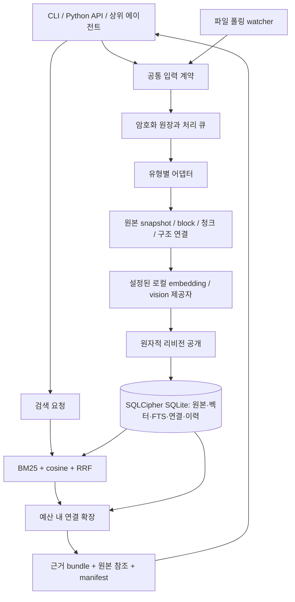

> **역사적 기록 — 현재 정본 아님.** 이 문서는 2026-09-09 최초 승인된 설계 원문을 그대로
> 보존한 것이다. 이후 별도 결정으로 **§3의 워처 다이어그램, §7.2 파일 워처(폴링),
> §10의 `watch` 명령과 `watch_roots`/`watch_entries` 테이블, §13의 "watcher
> add/change/delete" 시나리오가 대체되었다** — core에 내장 워처를 두는 대신, 신규/
> 변경/삭제 감지·워처·폴링·스케줄은 소비 프로젝트의 외부 배선이고 core는 명시적
> add/update/delete 요청만 처리한다. 그 외 섹션(암호화, 데이터 모델, 검색/확장,
> 근거 반환, CLI 어휘 대부분)은 여전히 유효한 설계 방향의 출발점이다.
>
> 현재 정본 문서 인덱스: [`../README.md`](../README.md)
> 대체 결정 기록: [`../decisions/log.md`](../decisions/log.md)
> 최신 책임 경계 계약: [`../contracts/consumer-integration.md`](../contracts/consumer-integration.md)
>
> 이 문서 본문의 로컬 경로(작업 워크트리 경로 등)는 작성 당시 기록이며, 현재 활성
> 문서에는 옮기지 않는다.

---

# AI RAG — 암호화된 로컬 범용 RAG 엔진 이식 설계

- 상태: **사용자 설계 승인 — §12 순서로 구현 진행** (2026-09-09, §15 전 항목 승인)
- 작성일: 2026-09-09
- 작업 위치: `ai-feature-pack/.worktrees/rag-transplant`
- 제안 배치: `feature-pack/rag/`
- 승인 시점 산출물: 이 설계 문서. 승인 전 초기 구현 파일은 모두 철회했으며, 이후 구현은 승인된 범용·암호화 설계를 기준으로 진행한다.
- 진행 순서: 설계 리뷰 → 사용자 승인 → 구현 → 운영 시뮬레이션 → 사용자 투어 → 완성 판정 → KakaoBot 메인에 이식 결과 보고.
- 협업 위치: 완성·운영 시뮬레이션·투어까지 사용자와 이 세션에서 진행한다. KakaoBot으로 작업 주도권을 넘기지 않는다.
- 역할 분담: `ft-airag-arch-astra`는 설계·검토·검증 근거·운영·투어, `ft-airag-worker-sonnet`은 문서/코드 확인·웹리서치·구현을 맡는다. 사용자가 worker 코드 작업을 승인했다.
- 소통 경로 정정: 설계·구현 승인·리뷰는 사용자와 이 세션이 직접 진행한다. KakaoBot#0는 승인 관문이 아니며 **완성 시 통합 결과만 보고**한다. 진행 중인 구현 승인은 유지된다.

## 1. 목표와 책임 경계

**가볍고 암호화된 로컬 SQLite 벡터 데이터베이스를 중심으로, 여러 형태의 데이터를 수집·갱신·보존하고, 검색과 청크 연결 확장을 통해 원본에 닿는 근거 묶음을 반환한다.**

사용자 요구의 핵심은 일반화다. 파일 감시 CLI는 입력 수단 중 하나이며, 데이터 모델의 중심은 파일 경로나 Kakao 대화방이 아닌 **소스·리비전·청크·원본·연결**이다.

**BYZ와 다른 프로젝트가 이 패키지를 설치하고 연결하면 동일한 운영 계약으로 RAG 기반을 갖출 수 있어야 한다.** 특정 앱의 코드를 복사하거나 프로젝트마다 DB/청킹/검색 루프를 다시 구현하게 만들지 않는다. “완전한 기반”의 판정은 아래 기능·운영 시험과 새 프로젝트 설치 재현으로 구체화한다.

| AI RAG가 맡는 일 | 상위 에이전트가 맡는 일 |
|---|---|
| 문서·이미지·대화텍스트와 메타데이터의 등록·갱신·관리 | 어떤 목적에 어떤 자료를 사용할지 판단 |
| 암호화 저장, 원본 스냅샷, 청킹, 임베딩, 인덱스 생성 | 검색 근거를 바탕으로 답변·보고서·코드 등 생성 |
| 등록 대상의 변경 감시, 실패 감지, 재시도, 재색인 | 외부 서비스를 통한 실제 업무 실행 |
| 검색, 원본 링크와 원본 반환, 제한된 청크 연결 확장 | 추가 검색 필요성을 판단하고 검색 조건 조정 |
| 처리 상태·버전·출처·검색 매니페스트 제공 | 사용자에게 결과를 설명하고 최종 의사결정 |

여기서 데이터의 “생성”은 원본의 관리 사본, 정규화 표현, 청크, 벡터, 연결, 검색 근거 묶음의 생성을 뜻한다. 질문에 대한 최종 답변이나 업무 산출물 생성은 포함하지 않는다. 이미지에서 검색용 설명을 추출하는 처리는 입력 가공이며, 그 설명은 원본과 구분해 기록한다.

“어떤 데이터든”은 공통 입력·저장 계약과 교체 가능한 유형별 처리기를 뜻한다. 모든 바이너리를 임의로 문자열로 읽어 검색 가능하다고 주장하지 않는다. 처리기가 없는 형식은 원본 보관 여부와 검색 가능 여부를 분리해 `unsupported`로 알린다.

## 2. 조사 결과와 근거

### 2.1 확인한 원본

조사 기준은 KakaoBot `bootstrap` 워크트리의 커밋 `db89f671251a818fb5e9b843b1ee6f897bcb1184`다. 작업 중 원본 브랜치가 변할 수 있으므로, 승인 후 이식 시 이 기준과 실제 가져오는 파일의 해시를 기록한다.

| 원본 모듈 | 줄 수 | 현재 책임 | 독립 엔진에서의 처리 |
|---|---:|---|---|
| `chunk.py` | 248 | 닫힌 대화 윈도우의 추출식 요약·detail 청크·임베딩 | 청킹·overlap·출처 리비전 원칙을 계승하고 유형별 block 입력으로 일반화 |
| `index.py` | 111 | FTS5 BM25·NumPy cosine·RRF(k=60) | 검색 전략을 계승하고 collection·리비전·검색 가능 상태 필터를 공통 적용 |
| `manifest.py` | 54 | response job 기준 컨텍스트 입력 기록 | 작업 ID 의존을 제거하고 검색·확장 결과의 정확한 입력 스냅샷 기록 |
| `retrieve.py` | 146 | query embed·후보 결합·검색 기록·CAP-GATE 검사 | 독립 서비스 진입점으로 전환; Kakao 전용 권한·작업 실행 경로는 이식하지 않음 |
| `reuse.py` | 49 | 외부 소스 참조 반환 | 원본 URI·스냅샷 조회 및 재사용 참조 계약으로 일반화 |
| `vec_backend.py` | 114 | 선택적 sqlite-vec, 고정 차원 테이블, KNN 조회 | 암호화 DB의 벡터 저장·검색 backend와 embedding space 관리로 확장 |
| `window.py` | 220 | 대화방 idle/count/token window·overlap | 일반 block 경계와 대화 어댑터의 메시지 window를 분리 |
| 합계 | **942** | `__init__.py`는 0줄 | 원본 전체 앱을 가져오지 않고 알고리즘·불변조건을 이식 |

원본 `pyproject.toml`에는 `krb-rag` 진입점이 없다. 원본 7개 모듈에는 파일 add/change/delete watcher가 없다. `room_id`, `messages`, `conversation_windows`, `response_jobs`, CAP-GATE, BYZ 호출 문맥에 결합되어 있어 그대로 복사하면 독립 CLI가 되지 않는다.

원본 패키지는 Python 3.13, Frida, SQLCipher, cryptography, httpx, NumPy 등을 함께 요구하지만, 이 중 Frida·봇 운영·방 키 파생·전송 기능은 독립 RAG에 필요하지 않다. 필수 의존성과 선택 어댑터를 분리해야 한다.

### 2.2 이미 있는 실험을 활용할 부분

원본 `src/krb/db/connect.py`는 SQLCipher에 키를 적용한 후 실제 읽기 검증, 메모리 임시 저장, FK, WAL, busy timeout을 설정한다. 암호화는 새로 만드는 알고리즘이 아니라 이 연결 원칙을 일반화한다.

원본 `kakao-agent-bot-planning/harness/evidence/SIM/vec-001-bench.md`에는 SQLCipher 연결에서 sqlite-vec 로딩·벡터 검색·오키 거부·평문 미검출을 확인한 기록이 있다. 다만 해당 결과는 원본 환경과 합성 벡터에 대한 기록이다. 새 설치 환경, 실제 텍스트·이미지 임베딩, 변경 감시, 연결 확장까지 검증했다는 뜻은 아니다.

그 기록은 다음 설계 제약도 보여 준다.

- `room_seq` 같은 고유값에 가까운 값을 vec0 partition key로 쓰면 저장 공간과 성능이 크게 나빠졌다. 소스 리비전·청크 ID를 partition key로 쓰지 않는다.
- 후보를 일정 수만 가져온 뒤 필터링하면 적합한 결과가 후보 창 밖에 있을 수 있다. 보안·활성 리비전 필터의 정확성과 top-K 완전성을 따로 검증한다.
- vec0 조회 함수가 존재해도 실제 청크 생성 경로의 vector dual-write가 자동 완성되는 것은 아니다. 신규·수정·삭제 전 경로에서 벡터 반영을 확인한다.
- 원본 코드 일부의 “ANN” 표기와 달리 해당 실험의 vec0은 exact search로 기록되어 있다. 새 문서·CLI에서는 실제 backend 성격을 표시한다.

### 2.3 추가 확인한 공식 근거

- SQLCipher는 SQLite를 수정한 암호화 빌드이며 데이터 페이지와 WAL의 데이터 페이지를 암호화한다. 파일 기반 임시 저장에는 별도 주의가 필요하므로 이를 비활성화하는 연결·빌드 검증을 둔다. [SQLCipher 설계](https://www.zetetic.net/sqlcipher/design/)
- SQLite WAL은 같은 호스트의 reader/writer 동시 진행에 적합하지만 writer는 하나다. 따라서 모델 호출은 DB write transaction 밖에서 하고 publication만 짧게 수행한다. 운영 DB는 로컬 파일시스템에 둔다. [SQLite WAL](https://sqlite.org/wal.html)
- FTS5는 BM25와 쿼리 문법을 제공한다. 사용자 문자열은 리터럴 검색어로 변환하고, FTS5 실제 가용성은 설치 시 시험한다. [SQLite FTS5](https://sqlite.org/fts5.html)
- sqlite-vec는 SQLite 안에서 벡터 저장과 KNN 조회를 제공한다. 구체적인 필터 지원은 채택할 버전을 고정한 뒤 검증한다. [sqlite-vec](https://alexgarcia.xyz/sqlite-vec/), [KNN 조회 문서](https://alexgarcia.xyz/sqlite-vec/features/knn.html)

## 3. 전체 구조

> **[대체됨]** 아래 다이어그램의 "파일 폴링 watcher → 공통 입력 계약" 경로는 이후
> 결정으로 대체되었다 — 워처는 core가 아니라 소비 프로젝트에 있다. 나머지 구조는
> 여전히 유효한 방향이다. 최신 계약: [`../contracts/consumer-integration.md`](../contracts/consumer-integration.md)

독립 Python 패키지 `airag`와 CLI `ai-rag`를 제안한다. `krb-rag`는 이식 추적 및 기존 기대와의 호환을 위한 같은 진입점 별칭으로 등록한다. 두 이름의 동작·출력은 같다. 패키지 이름·DB·기본 collection에는 Kakao 식별자를 넣지 않는다.

CLI는 공통 서비스 API를 호출하는 얇은 어댑터다. watcher도 같은 ingest/update/delete 서비스를 사용한다. CLI·watcher·Python API가 각자 인덱스를 갱신하는 경로를 만들지 않는다. 초기에는 HTTP 서버·별도 vector 서버·상주 에이전트 프레임워크 없이 운영한다.

## 4. 암호화와 경량화

### 4.1 저장 경계

기본 저장소는 **SQLCipher DB 하나와 SQLite가 관리하는 동반 파일**이다. 원본 관리 사본, 텍스트, 벡터, FTS, 파일 경로, 메타데이터, 처리 큐, 청크 연결, 검색 이력 모두 같은 암호화 경계 안에 둔다. 원본 바이너리도 초기 버전에서는 DB BLOB으로 보존한다.

외부 파일의 `origin_uri`는 원래 위치다. 엔진이 보존하는 `original_ref`는 정확한 리비전의 관리 사본이다. 입력 후 외부 파일이 바뀌거나 사라져도 이 관리 사본으로 원본을 반환한다. 외부 파일 자체의 암호화 여부를 이 엔진이 변경하지는 않는다.

기본 모델 호출은 설정된 로컬 제공자만 사용한다. 원격 제공자는 명시적으로 설정했을 때만 연결하며, 저장 암호화와 모델 호출 시 데이터 전달은 별개임을 상태에 표시한다. SQLCipher·키가 없으면 평문 SQLite로 자동 전환하지 않는다.

### 4.2 키 관리

- DB 키는 32바이트 난수를 사용한다. 기본 키 제공자는 OS 보안 저장소이며, macOS에서는 Keychain 연결을 우선 구현한다.
- 자동화 환경에는 키를 읽는 전용 file descriptor 등 대체 전달 경로를 제공한다. 키 문자열을 명령행 인자·DB 설정·로그·문서·manifest에 저장하지 않는다.
- 키 조회 → SQLCipher 확인 → 키 적용 → 실제 읽기 검증 → 스키마 검증 순으로 연다. 틀린 키와 손상된 DB는 실패로 끝나며 새 DB를 덮어 만들지 않는다.
- 메모리 임시 저장을 강제하고, 사용하는 드라이버의 컴파일 옵션 및 SQLCipher 기능을 `manage doctor`가 확인한다.
- 백업은 암호화 상태를 보존하는 경로만 제공한다. 복원은 새 경로에 검증해 열어 보고, 현재 DB를 자동 교체하지 않는다.
- Python 프로세스의 모든 메모리·OS swap까지 완전한 비밀 삭제를 보장한다고 주장하지 않는다. 본 계약은 저장 데이터 암호화와 키 노출 최소화다.

### 4.3 의존성 배치

| 계층 | 제안 의존성 | 이유 |
|---|---|---|
| 필수 코어 | Python, SQLCipher 대응 드라이버, sqlite-vec | 서버 없이 암호화 저장과 벡터 검색 |
| 기본 검색 | SQLCipher 빌드의 FTS5 | 키워드 검색과 hybrid retrieval |
| 기준 검증 backend | Python exact cosine; NumPy는 선택 | vec0 결과 검증 및 명시적 소규모 복구 경로 |
| 입력 어댑터 | 텍스트·JSON 기본; PDF·DOCX·이미지 처리는 선택 설치 | 모든 사용자에게 큰 문서·영상 스택을 설치시키지 않음 |
| 모델 제공자 | 설정된 로컬 text embedding·vision/OCR 제공자 | 모델 런타임과 가중치를 코어 패키지에 묶지 않음 |

경량화는 필수 기능을 생략하는 것이 아니라 저장·운영 코어와 무거운 모델·파서를 분리하는 것이다. 이미지까지 쓰는 완성 환경에는 실제 이미지 처리 제공자도 연결해 검증한다. 모델을 설치하지 않은 상태를 전체 RAG 준비 완료로 표시하지 않는다.

## 5. 공통 데이터 계약

### 5.1 입력 단위

모든 입력은 `IngestRequest`로 정규화한다.

| 필드 | 의미 |
|---|---|
| `collection` | 검색과 모델 설정의 관리 범위. 기본 `default` |
| `source_key` | 호출자가 안정적으로 부여하는 논리 ID. 파일은 정규화된 URI, 대화는 외부 시스템+메시지/세션 ID |
| `media_type` | MIME 유형. 확장자만으로 처리 성공을 가정하지 않음 |
| `origin_uri` | 원본 위치. 파일·외부 링크·대화 시스템 링크 등. 없는 경우 내부 URI 발급 |
| `content` 또는 `content_ref` | 실제 바이트·텍스트 또는 읽을 로컬 입력 참조 |
| `metadata` | 제목·시간·언어·태그·작성자 등 선택적 메타데이터 |
| `relations` | 부모 문서·답글·첨부 등 호출자가 알고 있는 연결 |
| `idempotency_key` / `expected_revision` | 재전송 중복 방지 및 동시 갱신 충돌 검출 |

같은 collection/source_key와 같은 내용·처리 profile은 no-op이다. 같은 논리 소스의 내용이 바뀌면 새 리비전이다. 해시가 같아도 별개 소스의 provenance를 합치지 않는다. 원본 바이트 저장만 해시 기반으로 중복 제거할 수 있다.

### 5.2 유형별 입력과 검색 표현

| 유형 | 분할·정규화 | 원본으로 돌아가는 anchor | 1차 완성 범위 |
|---|---|---|---|
| TXT·Markdown | 제목·문단·줄·문자 범위 | 리비전 + 줄/문자 offset | 기본 지원 |
| JSON·JSONL·대화텍스트 | 레코드 또는 메시지 경계; 역할·시간·답글 보존 | record/message ID 및 범위 | 기본 지원 |
| PDF·DOCX | 페이지·문단·표를 block으로 추출 | 페이지/문단/표 위치 | 선택 어댑터지만 설치·실동작 시험 포함 |
| PNG·JPEG 이미지 | 원본 + OCR 텍스트 + 시각 내용의 검색 표현 | 이미지 ID·크기·가능하면 영역 좌표 | 실제 이미지 처리 제공자 연결까지 완성 범위 |
| 기타 바이너리 | 원본과 메타데이터 보관; 등록된 어댑터가 있을 때 파생 처리 | 원본 snapshot ID | 미지원 형식을 검색 가능 상태로 표시하지 않음 |

이미지에서 OCR 텍스트, 모델의 시각 설명, 직접 image embedding은 다른 representation이다. 어떤 방식으로 인덱싱했는지 결과에 표시한다. 그림·사진은 OCR만으로 의미 검색이 완성되지 않으므로 글자 없는 이미지 시나리오도 통과해야 한다.

최초 이미지 경로는 **로컬 vision/OCR → 출처가 있는 검색 표현 → text embedding**으로 제안한다. text/image를 같은 공간에 넣을 수 있는 제공자가 있으면 native multimodal embedding 어댑터로 추가한다. 서로 호환되지 않는 text/image 벡터를 단순 cosine으로 비교하지 않는다. 이 선택은 가벼운 코어를 유지하면서 이미지 원본을 검색할 수 있지만, vision 설명의 누락·오류에 검색 품질이 의존한다는 트레이드오프가 있다.

### 5.3 원본·청크·파생 표현 구분

- `source`: 논리적인 원천 자료. 주소가 아니라 식별자가 중심이다.
- `source_revision`: 특정 입력 상태의 불변 snapshot. 내용 해시, 원본 바이트 참조, 처리 버전을 가진다.
- `block`: 어댑터가 추출한 페이지·문단·메시지·이미지 영역 등 의미 단위.
- `chunk`: 검색에 사용할 제한 길이의 단위. 한 개 이상의 block을 참조한다.
- `representation`: 원문, OCR, 추출식 요약, vision 설명 등. 직접 원문과 추정 표현을 구분한다.
- `embedding`: chunk/representation과 embedding space에 연결된 벡터.

기본 detail 청크는 원본의 800~1,200 추정 토큰·10~15% overlap 출발점을 계승하되, 실제 제공자의 입력 한도를 우선한다. 과대 문단·단일 메시지도 한도를 넘지 않게 분할한다. overlap은 중복된 사실이 아니라 연속된 문맥을 위한 참조다. 검색 bundle을 만들 때 겹치는 원문 범위를 합쳐 중복 전달을 줄인다.

대화는 메시지 역할·ID·timestamp·reply-to를 보존하는 어댑터가 window를 만든다. Kakao의 5분 idle이나 120건 조건은 범용 코어의 고정 규칙이 되지 않는다. 상위 에이전트가 만든 텍스트도 명시적으로 등록할 수 있으며, `authorship`와 `derived_from`을 기록해 인간 원문과 구분한다.

## 6. SQLite 논리 모델

아래는 논리 테이블 설계다. 실제 DDL·마이그레이션은 리뷰 승인 후 작성한다.

> **[부분 대체됨]** `watch_roots`/`watch_entries`는 core 내장 워처 전제였다 —
> 최신 계약에서는 core가 감시하지 않으므로 이 두 테이블은 core 스키마에 포함하지
> 않는다. 나머지 테이블은 여전히 유효한 논리 설계다.

| 테이블/영역 | 핵심 내용 |
|---|---|
| `db_meta`, `schema_migrations` | DB 식별, 스키마 버전·체크섬, 전역 publication sequence |
| `collections` | 명칭, 활성 embedding profile, 검색·보존 정책 |
| `sources` | 논리 ID, origin URI, 유형, active revision, 삭제 상태, 상태 세대 |
| `source_revisions`, `original_blobs` | 불변 원본 snapshot, 콘텐츠 해시, 크기, 처리 버전; 암호화 BLOB |
| `blocks`, `chunks`, `chunk_blocks` | 추출 표현, 원문 anchor, 순서, token estimate, representation 성격 |
| `embedding_spaces`, `embeddings` | provider·model·revision·dimension·modality·전처리 fingerprint 및 float32 벡터 |
| `active_chunks_fts`, `vec_*` | 현재 검색 가능한 리비전의 파생 인덱스 |
| `chunk_edges` | 두 청크의 연결 유형·방향·근거·생성 리비전 |
| ~~`watch_roots`, `watch_entries`~~ | ~~감시 설정, 마지막 정상 inventory, fingerprint, 중단·오류 상태~~ — 대체됨(위 참고) |
| `ingest_jobs`, `job_attempts` | 처리 요청, dedupe 키, pending/running/failed/ready, lease, 재시도 |
| `retrieval_runs`, `manifest_items` | query, corpus snapshot, 선택 항목과 순서, 확장 경로, 원본 리비전, 예산 |

원본·리비전·청크가 정본이고 FTS·vec0는 재생성 가능한 파생 인덱스다. 이전 리비전의 원본과 청크는 이력에 남기고 기본 검색 인덱스에서는 제거한다. 검색 필터에서도 활성 리비전을 검증하여 파생 인덱스의 불일치가 과거 데이터 노출로 이어지지 않게 한다.

embedding space는 차원 수만으로 식별하지 않는다. 같은 384차원이라도 모델·리비전·모달리티가 다르면 별개다. vec 테이블의 식별자는 검증된 내부 ID에서 생성하며 사용자 입력을 SQL 식별자로 직접 쓰지 않는다.

vec0의 차원은 테이블 생성 시 고정되므로, embedding space 등록 시 실제 설정된 차원으로 테이블을 provision한다. KakaoBot의 4개 고정 차원 목록을 계승하지 않는다. 내부 테이블명·차원·space fingerprint·생성 스키마 버전을 registry에 기록하고, 등록 및 DDL을 트랜잭션으로 처리한다. 같은 차원이더라도 다른 embedding space의 벡터를 섞어 비교하지 않는다.

초기 기본 검색 범위는 collection 하나다. 여러 collection 검색은 명시적으로 지정한다. collection은 논리 범위이며, 같은 OS 사용자·같은 DB 키 사이에 별도의 접근권한 격리를 제공한다고 주장하지 않는다.

## 7. 등록·갱신·삭제와 리액티브 감시

> **[§7.2 전체 대체됨]** 아래 "파일 watcher" 절은 core 내장 폴링 워처를 전제한다 —
> 최신 결정으로 감지/워처는 소비 프로젝트의 외부 배선이 되었다. §7.1과 §7.3은
> 여전히 유효한 방향(단, 트리거가 소비자 요청으로 바뀜)이다. 최신 계약:
> [`../contracts/consumer-integration.md`](../contracts/consumer-integration.md)

### 7.1 공통 상태 전이

`접수 → 원본 확보 → 추출 → 청킹/연결 → 임베딩 → 검증 → 원자적 공개(ready)`

접수와 검색 가능 상태는 다르다. `add`는 기본적으로 처리 완료까지 기다리고, 비동기 옵션은 job ID와 `pending`을 반환한다. 실패 시 실패 단계와 재시도 가능 여부를 반환한다. 지원하지 않는 형식이나 제공자가 없는 입력을 성공 처리하지 않는다.

무거운 파일 읽기·OCR·vision·embedding 호출은 write transaction 밖에서 실행한다. 최종 트랜잭션에서 소스의 expected revision/generation을 재검증한 뒤 청크·연결·embedding·FTS·활성 revision·publication sequence를 함께 갱신한다. 중간 실패가 생기면 이전 검색 가능 리비전이 유지된다.

busy timeout을 넘긴 저장소 경합은 retryable 오류로 분류한다. 이미 원장에 접수된 job은 제한된 backoff로 재시도한다. 접수 자체가 실패한 요청은 durable pending인 것처럼 표시하지 않고, 호출자가 같은 idempotency key로 재시도할 수 있는 실패를 반환한다.

갱신을 관측했지만 처리 중이거나 실패한 소스는 `stale=true`와 pending revision을 관리 화면 및 검색 결과에 표시한다. `require_fresh` 요청은 이런 결과를 제외하거나 준비 미완료로 반환한다. 이전 리비전을 최신으로 표시하지 않는다.

### 7.2 파일 watcher (대체됨 — 위 안내 참고)

기본 구현은 지속 폴링이며, 초기 제안 간격은 2초다. OS 이벤트 라이브러리는 이후 같은 reconcile 경로에 연결할 수 있다.

1. 시작 시 DB에 등록된 감시 대상과 마지막 정상 inventory를 읽는다.
2. 디렉터리 inventory를 수집하여 신규·변경·삭제 후보를 얻는다.
3. 짧은 안정화 구간 후 파일을 읽고 읽기 전후 식별자·크기·mtime을 검증한다.
4. 파일 해시와 논리 ID로 중복 이벤트를 합치고 durable ingest job을 기록한다.
5. 공통 ingestion 경로로 처리한다. 파일 add/change/delete마다 독립적인 결과 이벤트를 남긴다.
6. 재시작 시 미완료 job과 만료 lease를 복구하고 전체 inventory를 reconcile한다.

평상시 stat fingerprint를 활용하되 정기 전체 해시 검사로 같은 크기·mtime의 변경을 회수한다. 따라서 “stat 변경 감지 지연”과 “전체 해시 검사 지연”을 별도 상태로 공개한다. `watch --once --verify-content`는 결정적인 전체 확인 경로다.

루트 경로가 사라지거나 읽기 권한이 없거나 순회가 불완전하면 그 subtree의 대량 삭제를 추정하지 않는다. 개별 파일이 정상 inventory에서 빠졌음을 확인한 경우에만 삭제 이벤트로 처리한다. DB·WAL·임시 출력·숨김 관리 디렉터리와 symlink는 기본 감시에서 제외한다. ignore 정책 변경으로 검색 대상이 달라지는 것도 명시적 관리 변경으로 기록한다.

파일 이동은 초기 버전에서 이전 URI 삭제 + 새 URI 등록으로 처리한다. 해시만 보고 서로 다른 소스를 자동 병합하지 않는다. 호출자가 안정적인 source_key를 제공하는 입력은 위치 변경과 논리 소스를 분리할 수 있다.

### 7.3 수정·삭제·보존

- 문서 내용 수정은 새 원본 snapshot과 리비전을 만든다.
- 원본 바이트가 같고 embedding/추출 profile만 바뀌면 원본 BLOB은 재사용하고 파생 처리 버전을 새로 만든다.
- `delete`는 지정 소스의 검색 제외와 감시 자동 재등록 방지를 수행한다. 외부 원본 파일을 지우지 않는다.
- 삭제된 소스와 과거 리비전은 기본 검색·연결 확장에 나오지 않는다. 명시적 history 조회만 가능하다.
- `restore`는 보존된 소스의 tombstone을 해제하고 필요한 reconcile을 수행한다. watcher만 실행해서 수동 삭제 소스가 되살아나지 않는다.
- 물리 purge·원본 파일 삭제·DB 삭제·자동 이력 정리는 1차 버전에 넣지 않는다. 저장 용량과 이력 크기는 관리 명령으로 보고한다.

원본 전체를 보존하므로 용량이 증가한다. 초기에는 입력 크기 상한·content-addressed BLOB 중복 제거·명시적인 용량 표시로 관리한다. 대형 파일용 별도 암호화 object store는 후속 확장점으로 남기고 이중 저장소의 원자성 문제를 초기 구현에 들이지 않는다.

## 8. 검색과 청크 연결 확장

### 8.1 기본 검색

1. query, collection, source/type/time 필터, top-K와 예산을 검증한다.
2. 선택된 embedding space에 맞는 query vector를 얻는다. 모델 호출 중 DB transaction을 유지하지 않는다.
3. 짧은 DB 읽기 snapshot에서 후보를 얻는다. BM25와 vector 모두 같은 활성 리비전·삭제·범위 조건을 적용한다.
4. 각 채널의 후보 순위에 원본의 RRF `k=60`을 적용한다. 기본 후보 수 100, 최종 결과 10은 조정 가능한 초기값이다.
5. 선택적으로 연결 확장을 하고 동일 snapshot 기준의 근거 묶음을 만든다.
6. 정확한 리비전·청크·순서·점수·확장 경로·제공자 profile을 manifest로 기록하고 반환한다.

3~5단계의 모든 후보 조회와 graph hop은 하나의 명시적 읽기 트랜잭션을 공유한다. hop별 autocommit 조회나 별도 연결을 사용하지 않는다. query embedding을 얻은 후 이 트랜잭션을 시작할 때 collection/profile generation을 재검증하며, 그 사이 profile이 바뀌었으면 새 profile로 재시도한다. 정확한 반환 내용을 메모리에 확정한 뒤 읽기 트랜잭션을 닫고 manifest를 별도 짧은 write transaction으로 저장한다.

기본 backend는 **SQLCipher + sqlite-vec**를 제안한다. 호환성 검증 실패 시 몰래 다른 저장소를 만들지 않고 설치/상태 오류를 낸다. 명시적인 exact cosine 진단 경로는 유지한다.

필터가 vec0에서 직접 적용되지 않으면 후보를 일정 개수만 잘라 사후 필터하는 방식으로 완전성을 약속하지 않는다. 해당 질의는 적합한 행 집합의 exact cosine 경로로 실행하거나, 적합 후보를 충분히 확보할 때까지 제한과 결과 완전성을 명시하는 방식으로 처리한다. 첫 구현은 정확성 우선의 exact 경로를 선택한다.

실행 결과에는 실제 사용한 backend와 fallback 사유를 기록한다. vec0의 필터 지원 여부는 채택한 버전·컬럼 종류의 실제 probe로 정하며 모든 query-time 필터가 미지원이라고 가정하지 않는다. 성능 시험은 무필터와 대표적인 source/type/time 필터 질의를 분리해 측정한다.

의미 임베딩이 없는 운영 환경에서 해시 벡터를 기본 의미 검색으로 사용하지 않는다. 해시/결정적 벡터는 테스트 전용이다. keyword-only 모드는 사용자가 명시적으로 선택할 수 있고 결과 `mode`에 표시한다.

### 8.2 연결 종류

| 연결 | 생성 근거 | 확장 시 의미 |
|---|---|---|
| `next`, `previous` | 같은 소스 리비전의 block/청크 순서 | 앞뒤 문맥 보충 |
| `parent`, `child` | 제목·문단·문서/첨부 구조 | 상위 개요 또는 하위 세부 근거 |
| `reply_to` | 대화 입력의 원본 메시지 ID | 질문·답변·대화 흐름 복원 |
| `references` | 문서 링크, source_key, 명시적 관계 | 참조된 다른 원본으로 이동 |
| `derived_from` | OCR·vision 표현·요약의 생성 근거 | 검색 표현에서 실제 원본으로 복귀 |
| `similar` | 같은 embedding space의 거리와 profile | 관련 가능성이 있는 자료; 추정 연결로 표시 |

구조적 연결은 publication 시 리비전과 함께 저장한다. `similar`는 처음부터 모든 청크 쌍을 저장하지 않고 요청 시 top-N 후보로 계산한다. 실제 반환한 경로와 점수는 manifest에 남긴다. 비슷하다는 이유만으로 동일 사실이나 명시적 인용으로 취급하지 않는다.

연결 대상 URI는 자동으로 인터넷에서 가져오지 않는다. 이미 등록된 소스일 때 해석하거나 `unresolved`로 반환한다. 외부 수집은 입력 어댑터 또는 상위 에이전트가 명시적으로 수행한다.

### 8.3 확장 계약

`search`의 `expand` 옵션 또는 별도 `expand` 요청으로 시작 청크를 지정한다. 초기 제안값은 깊이 1, 최대 20청크, 최대 8,000 추정 토큰이며 caller가 낮추거나 설정된 상한 내에서 조정할 수 있다.

- 순회는 visited 집합을 사용하여 순환·중복을 차단한다.
- 구조 연결 우선, semantic 연결은 요청 시 활성화한다. semantic 후보는 profile별 기준을 사용하며 공통 cosine 임계값 하나로 모든 모델을 판단하지 않는다.
- collection·소스·유형·삭제·활성 revision 필터는 매 hop에 적용한다.
- 각 추가 청크에는 `seed_chunk_id`, `via`, `depth`, `reason`, 구조적/추정 구분을 붙인다.
- 예산에 걸리면 `truncated`, 소모량, 중단 이유, 아직 확장 가능한 참조를 반환한다. 무제한으로 이웃을 모으지 않는다.
- 긴 문맥을 줄이기 위해 엔진이 임의의 답변 요약을 생성하지 않는다. 원문 범위 병합과 제한된 청크 선택으로 전달량을 제어한다.

기존 manifest에서 확장을 이어갈 경우 그 manifest의 snapshot을 사용하거나, 새로운 live snapshot임을 명시적으로 선택해야 한다. 과거 seed와 최신 이웃을 표시 없이 섞지 않는다. 구현을 단순화하기 위해 v1의 기본 재현 경로는 **저장된 manifest 재조회**, 새 확장은 **새 run + 명시된 snapshot**으로 제한한다. 과거 전체 corpus에 대한 임의 재검색은 필수 범위에 넣지 않는다.

## 9. 반환 계약 — 청크, 원본 링크, 원본

검색 결과는 `EvidenceBundle`이다. 상위 에이전트가 바로 읽고 추가 조회할 수 있어야 한다.

| 항목 | 반환 내용 |
|---|---|
| run | 검색 ID, query, schema version, snapshot sequence, 실행 mode/profile |
| hits | chunk ID, rank, 각 채널 rank/score, 내용, representation 유형 |
| citation | source ID/key, 정확한 revision, 원본 URI, 내부 original reference, 해시, anchor |
| originals | 포함된 원본 또는 안전하게 가져올 수 있는 retrieval reference, MIME, 크기 |
| expansion | seed·경로·관계·깊이·추정 여부 |
| completeness | pending/stale 입력, 부분 실패, budget 사용량, 잘린 이유 |
| manifest | 동일한 근거 묶음을 다시 조회하는 식별자 |

기본 검색은 청크 원문과 원본 링크·관리 사본 참조를 반환한다. **원본 반환 자체도 필수 기능**이며 `fetch original`로 정확한 바이트를 조회한다. 작은 텍스트 원본은 검색 옵션으로 inline 포함할 수 있다. 이미지·대형 원본은 기본 JSON에 무제한 base64로 넣지 않고 명시적 fetch 스트림/출력 경로로 반환한다. 상위 Python API는 bytes/stream으로 받을 수 있다.

검색 결과 전체 원본을 요청하면 항목별 포함 여부와 byte budget을 표시한다. 원본을 참조만 제공한 경우 원본 전체가 이미 전달된 것처럼 표시하지 않는다. output/export는 사용자가 요청한 결과 전달이며 관리 로그에 원본·키를 중복 기록하지 않는다.

manifest는 상위 에이전트가 **실제로 사용한 최종 프롬프트 전체**를 증명하지 않는다. AI RAG가 반환한 근거의 정확한 내용을 증명한다. 상위 에이전트의 최종 입력 기록이 필요하면 별도 사용 확인 정보를 연결할 수 있지만 초기 필수 기능은 아니다.

## 10. 표준 인터페이스와 운영 명령

> **[일부 대체됨]** 아래 표의 `watch` 명령은 core에 존재하지 않는다 — 최신 계약:
> [`../contracts/cli.md`](../contracts/cli.md), [`../contracts/consumer-integration.md`](../contracts/consumer-integration.md)

모든 일반 명령은 같은 응답 envelope를 사용한다: `schema_version`, `request_id`, `ok`, `command`, `data`, `error`. watch는 같은 envelope의 JSON Lines 이벤트 스트림이며 이벤트 순서 ID와 상태를 포함한다. 진행 로그는 stderr로 분리한다.

| 명령군 | 책임 |
|---|---|
| `init` | 새 암호화 저장소·키 참조·기본 collection 설정 |
| `add` | 파일/디렉터리/텍스트/구조화 입력의 등록·내용 갱신; 동기 처리 또는 job 반환 |
| `manage status/list/show` | 소스·리비전·지원 기능·pending/failed/stale·용량 조회 |
| `manage sync/retry/reindex` | 감시 reconcile·실패 재시도·embedding/추출 profile 변경 |
| `manage pause/resume` | 감시·처리 일시 중지와 재개. pause 자체는 기존 검색 결과를 삭제하지 않음 |
| `manage restore` | 삭제 tombstone의 명시적 복구 |
| `manage doctor/verify/backup` | 암호화·확장·모델·FK·파생 인덱스 상태 확인 및 암호화 백업 |
| `delete` | 선택 소스의 검색 제외·감시 재등록 방지; 이력 보존 |
| `search` | 키워드·벡터·hybrid 검색 및 선택적 확장 |
| `expand` | seed 청크의 연결 확장과 새 근거 묶음 반환 |
| `fetch source/chunk/original/manifest` | 정확한 ID·리비전의 내용 또는 원본 조회 |
| ~~`watch`~~ | ~~지속 감시·처리·이벤트 스트림~~ — 대체됨(위 참고) |

사용자는 사람용 출력과 JSON을 선택할 수 있지만 의미·상태·오류 코드는 같다. 초기 exit code는 0=성공, 2=입력/설정, 3=미지원 기능/제공자 준비 미완료, 4=처리/저장 실패, 5=버전 충돌로 제안한다. 검색 결과 0건은 정상 성공이다. 혼합 입력 배치에 실패가 있으면 성공 항목과 실패 항목을 모두 반환하고 전체 성공으로 표시하지 않는다.

원본 바이너리 스트리밍은 JSON envelope와 stdout에 섞지 않는다. 메타데이터 JSON 또는 명시적 raw output을 선택하는 예외 계약을 문서화한다.

### 10.1 다른 프로젝트가 사용하는 계약

BYZ·KakaoBot·기타 프로젝트는 **AI RAG의 소비자**다. AI RAG 코어에서 이 프로젝트들을 import하지 않는다. 소비자는 다음 정보만 지정한다.

| 소비자가 제공 | AI RAG가 제공 |
|---|---|
| DB 위치와 KeyProvider 참조 | 암호화 저장소 생성·개폐·검증·백업 |
| collection 및 논리 source_key | 원본·리비전·청크·벡터·연결·중복 처리 |
| 입력 내용·원본 URI·관계 메타데이터 | 유형별 처리와 상태·실패·재시도 관리 |
| 로컬 embedding/vision profile 또는 제공자 구현 | profile 검증·공간 분리·재색인 |
| query·필터·확장/반환 예산 | EvidenceBundle·원본 fetch·manifest |

배포 단위에는 설치 가능한 wheel, console scripts, 버전이 있는 JSON 계약, Python public API, 설치 검증 명령, 합성 자료 운영 시뮬레이션을 포함한다. 저장소 checkout 경로·개인 홈 디렉터리·Kakao 방 ID가 설치된 런타임에 필요하지 않아야 한다.

공유 native 의존성은 검증한 호환 범위를 선언하고, 재현 가능한 시험 환경의 정확한 버전은 lock/evidence에 기록한다. 기존 소비자의 SQLCipher pin과 충돌하면 숨기지 않는다. 지원 조합으로 조정하거나, 별도 환경에 설치한 CLI/JSON 경계를 통해 연결한다. 취약성 수정과 ABI 확인 없이 단지 오래된 pin을 만족시키기 위해 드라이버를 내리지 않는다.

프로젝트 설정은 프로젝트/저장소별로 분리한다. 설치만으로 사용자 전역 shell 설정, 기존 프로젝트 DB, 모델 endpoint, 에이전트 지침을 변경하지 않는다. 기존 저장소를 여는 작업은 스키마 버전을 확인하고, 데이터가 바뀌는 migration은 명시적 명령과 암호화 백업을 거친다.

`manage doctor`는 설치 여부만 확인하지 않고 encryption, vector, FTS, key access, text embedding, image processing, watcher, 원본 보존 설정을 capability별로 보여 준다. 활성화한 기능 중 준비되지 않은 것이 있으면 `ready=false`와 해결할 항목을 반환한다. 텍스트 전용 profile과 이미지 포함 profile은 준비 완료 조건이 다르며, 이번 완성 시연은 이미지 포함 profile을 사용한다.

검증에는 **깨끗한 별도 샘플 프로젝트가 패키지만 설치해 공통 API로 입력·검색·확장·원본 조회를 수행하는 consumer test**를 추가한다. BYZ 통합을 흉내 내기 위해 BYZ 내부 DB를 수정하지 않는다. BYZ 실제 연결은 이후 동일 계약을 사용하는 어댑터로 진행한다.

## 11. 검토한 대안과 선택 이유

| 선택 | 대안 | 채택 이유 | 감수하는 비용 |
|---|---|---|---|
| SQLCipher + sqlite-vec | 평문 SQLite 또는 외부 vector DB | 암호화된 로컬 단일 운영 경계, 기존 검증 자산 활용 | 드라이버/확장 설치와 ABI 검증 필요 |
| vec0 기본, exact cosine 기준 경로 | NumPy만 기본 | DB 안의 vector 조회와 작은 코어, 원본 벤치의 가능성 | 새 환경에서 성능·필터 동치성 재검증 |
| 원본 snapshot 보존 | 원본 경로만 보관 | 원본 변경·삭제 후에도 정확한 근거 반환 | DB 용량 증가 |
| 공통 ingest 계약 + 어댑터 | 유형마다 별도 DB·명령 | 문서·이미지·대화가 동일 관리·검색 API 사용 | 어댑터 capability와 버전 관리 필요 |
| durable 큐 + 원자적 publication | watcher callback에서 즉시 덮어쓰기 | 재시작·실패·동시 변경을 복구 가능 | 처리 상태와 lease 구현 필요 |
| 폴링 + reconcile | OS native 이벤트만 사용 | 구현 단순, 재시작·누락 회복 경로 동일 | 감지 지연과 주기적 I/O |
| 구조 연결 + 요청 시 semantic 확장 | 별도 graph DB 또는 모든 pair graph | 서버·O(N²) 저장을 피하고 확장 근거 명시 | 질의 시 추가 vector 계산 |
| 로컬 vision 설명 기반 이미지 검색 | multimodal 모델을 코어에 내장 | 무거운 런타임을 분리하고 원본 연결 유지 | 설명 품질에 검색 recall이 의존 |
| 프로파일 고정·원자적 재색인 | 서로 다른 벡터를 한 테이블에서 비교 | 모델 변경 후 의미 공간 혼합 방지 | 재색인 동안 중복 파생 저장 공간 |
| tombstone + 명시적 restore | 실제 원본/이력 즉시 삭제 | 검색 제외와 재현성 보존을 함께 만족 | 보존 데이터의 용량 관리 필요 |

별도 LangChain/LlamaIndex 계층, 웹 UI, 원격 DB 서비스, 답변 생성 에이전트는 1차 엔진에 요구하지 않는다. 필요해지면 동일 Python API 위에 붙일 수 있다.

## 12. 승인 후 구현 순서

> **[6단계 대체됨]** 아래 "파일 watcher" 운영 단계는 최신 계약에서는 소비자 요청
> 처리로 대체되었다. 현재 순서: [`../delivery/roadmap-and-gates.md`](../delivery/roadmap-and-gates.md)

1. **설치·암호화 검증:** 독립 패키지와 두 CLI 진입점, SQLCipher/FTS5/vec0 probe, 키 전달, 잘못된 키 거부. 평문 자동 fallback 없음 확인.
2. **저장·입력 계약:** 원본 snapshot·리비전·collection·job 원장·마이그레이션, 텍스트/구조화 대화 어댑터, public API.
3. **실제 임베딩·검색:** embedding space, chunk/FTS/vec publication, RRF, 검색·fetch·manifest 재조회. 로컬 실제 모델 연결.
4. **이미지·문서 어댑터:** PDF/DOCX·PNG/JPEG, OCR/vision representation과 원본 반환, 글자 없는 이미지 검색.
5. **청크 연결·확장:** 구조 관계 생성, reference 해석, 예산 있는 확장, provenance·중복 제거.
6. **운영:** 파일 watcher·durable retry·pause/resume·delete/restore·reindex·doctor·암호화 백업.
7. **시뮬레이션:** 아래 기준을 실제 CLI와 실제 암호화 DB로 실행하고 결과를 이 워크트리에 보존.
8. **사용자 투어:** 사용자와 혼합 자료를 넣고 등록→수정→검색→원본→확장→삭제→복구를 직접 확인.
9. **완성 판정·이식 보고:** 승인된 요구와 검증 결과를 대조하고 KakaoBot 메인에 패키지 경로·사용 계약·제한·통합 방법 보고.

worker-sonnet: 사용자가 `ft-airag-worker-sonnet` 한 명의 투입 및 코드 작업을 명시적으로 승인했다. 문서/코드 대조·웹리서치·반복 확인·코드 구현은 이 worker에 위임한다. 설계 결정·검토·검증 근거 판정·운영과 투어는 architect가 책임진다. 단계별 산출물과 증거를 검토한 뒤 다음 작업을 발주한다.

## 13. 운영 시뮬레이션과 완성 기준

아래는 실행 결과가 아니라 승인 후 수행할 시험 계획이다.

| 시나리오 | 통과 기준 |
|---|---|
| 암호화 DB 개폐 | 올바른 키로 재오픈 가능; 오키·키 없음·일반 SQLite에서 읽기 실패; DB/WAL에 합성 표식 평문 미노출 |
| 신규 문서 등록 | 원본 snapshot·청크·벡터·검색 결과·원본 fetch 해시가 일치 |
| 중복 재등록 | 동일 요청 재시도 시 원본 리비전·청크 중복 증가 없음 |
| 문서 갱신 | 새 리비전만 기본 검색; 구 manifest는 구 원본·청크를 그대로 반환 |
| 빈 문서·긴 문단·한글 | 원문 범위 누락 없이 처리; chunk 한도 준수; 빈 입력 상태 명시 |
| 대화텍스트 | 메시지 역할·순서·ID·reply-to 보존; 답글 연결 확장 가능 |
| PDF·DOCX | 내용·페이지/문단 anchor·원본 반환의 일치; 손상 파일 오류 보고 |
| 글자가 있는 이미지 | OCR/vision 표현으로 검색되고 이미지 원본 바이트·출처 반환 |
| 글자 없는 이미지 | 실제 vision 경로로 의미 검색 가능; 표현 생성 근거와 원본 구분 |
| watcher add/change/delete | 각각 실제 파일 이벤트 후 검색 상태에 반영; 재시작 후 수동 재등록 없이 복구 |
| 삭제·복구 | watcher가 수동 삭제를 부활시키지 않음; restore 이후에만 검색 복귀 |
| 파일 읽기/루트 장애 | 접근 불가를 삭제로 오판하지 않음; 오류 상태·기존 근거 보존 |
| 모델 실패·차원/개수 불일치 | 부분 벡터를 ready로 공개하지 않음; 재시도와 이전 리비전 상태 명시 |
| 모델 리비전 변경 | 공간 혼합 없음; 새 profile 준비 후 일괄 전환; 실패 시 이전 profile 유지 |
| 동시 실행·중단 복구 | add/watch/reindex 경쟁 시 중복 공개 없음; job lease 복구 가능 |
| 구조·semantic 확장 | 원본 관계와 추정 관계 구분; 순환 종료; 예산 준수; 삭제/다른 범위 우회 없음 |
| 선택적 원본 포함 | inline/fetch/raw 계약 준수; byte budget 초과 시 누락 여부 명시 |
| manifest 재현 | 선택 내용·원본 revision·순서·확장 경로가 갱신/삭제 후에도 동일 |
| 백업 복원 | 새 위치에 복원한 암호화 DB에서 근거·원본·검색 확인 |
| CLI/API 계약 | 같은 요청의 필드·상태 의미 일치; JSON stdout 오염 없음; 오류/0건 구분 |
| 새 프로젝트 설치·소비 | 원본 checkout·KakaoBot/BYZ import 없이 패키지만 설치해 등록·검색·확장·원본 조회 성공; 재실행 시 설정/데이터 중복 생성 없음 |

검색 품질은 결정적 벡터 시험과 실제 의미 검색을 분리한다. 전자는 transaction·필터·ranking 동치성을 검증하고, 후자는 한글/영문 문서·대화·이미지 정답 세트로 Recall@K/MRR와 실패 질의를 보고한다. 합성 hash 시험 통과를 실제 RAG 품질 통과로 대신하지 않는다.

성능은 1천·1만·10만 청크에서 DB 크기, RSS, 색인 시간, 검색 p50/p95, 확장 비용을 측정한다. 모델 추론 시간과 DB 검색 시간을 분리한다. 제안 기준은 **1만 청크·384차원·warm query vector에서 DB 검색+깊이 1 구조 확장 p95 500ms 이하, 코어 RSS 300MiB 이하**다. 이는 아직 실측값이 아니며 장치·모델·차원을 기록해 판정한다. 10만 청크는 규모 한계와 개선 필요성을 확인하는 시험이며 같은 수치를 무조건 보장하지 않는다.

1만 청크 기준은 무필터뿐 아니라 선택도 약 10%의 source/type/time 필터 질의에도 각각 적용한다. 사용 backend별 측정값을 분리하고, 원본 KakaoBot 벤치의 속도 배율을 이 패키지의 성능으로 대신하지 않는다.

“완성”은 코드 작성 완료가 아니라 지원 입력 모두의 실제 처리, 암호화 저장, add/update/delete 감시, 검색·원본 반환·확장, 실패 복구 시뮬레이션, 사용자 투어가 완료된 상태다. 모델 미설정이나 이미지 경로 미실행은 미완료 항목으로 남긴다.

## 14. 사용자 투어

1. 새 로컬 암호화 저장소를 열고 사용 중인 모델·검색 범위·지원 입력을 확인한다.
2. 짧은 문서, 관련 문서, 답글 관계가 있는 대화, 글자가 있는 이미지와 없는 이미지를 넣는다.
3. 일상어 질의로 검색하고 각 청크의 원본 링크·보존 원본을 확인한다.
4. 청크 연결을 한 단계 확장하여 왜 자료가 추가됐는지와 원본 위치를 확인한다.
5. 감시 중인 문서를 수정하고 새 검색 결과와 기존 manifest를 비교한다.
6. 문서를 지우거나 소스를 delete해 검색 제외를 확인한 뒤 보존 원본 조회·restore를 확인한다.
7. watcher를 재시작하고 미완료 처리·동기화 복구를 확인한다.
8. 상위 에이전트가 JSON bundle을 받아 사용할 수 있음을 확인하고 운영 흐름을 승인한다.

## 15. 이번 리뷰에서 확정할 사항

사용자가 **범용 엔진의 책임 경계, SQLCipher+sqlite-vec, 원본 snapshot 보존, 유형별 어댑터, 청크 연결과 제한된 확장, 상위 에이전트용 근거 반환**을 모두 승인했다. §12의 순서로 구현·검증·운영을 진행하며, 단계 보고는 추가 승인 요청이 아니다.

구현 단계에서 실제 환경에 맞춰 확정할 항목은 다음과 같다. 해당 값은 지금 검증됐다고 간주하지 않는다.

- 실제 로컬 text embedding 및 vision/OCR 제공자·모델·revision과 허용 메모리/디스크 크기.
- 첫 운영 corpus 크기와 입력당 원본 보존 크기 상한.
- macOS 우선 완성 후 Linux 지원을 어느 단계까지 함께 검증할지.

현재 제안은 macOS를 첫 실동작 대상으로 삼고, 코어 계약은 플랫폼 중립으로 유지하는 것이다. 모델과 장치 정보가 정해지면 검색 품질·자원 예산을 구체화한다. 외부 서비스 송신이나 무거운 모델 자동 다운로드를 설계 승인만으로 추정해 실행하지 않는다.
